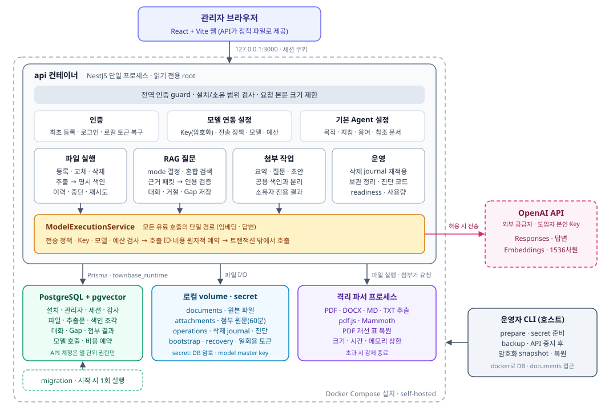
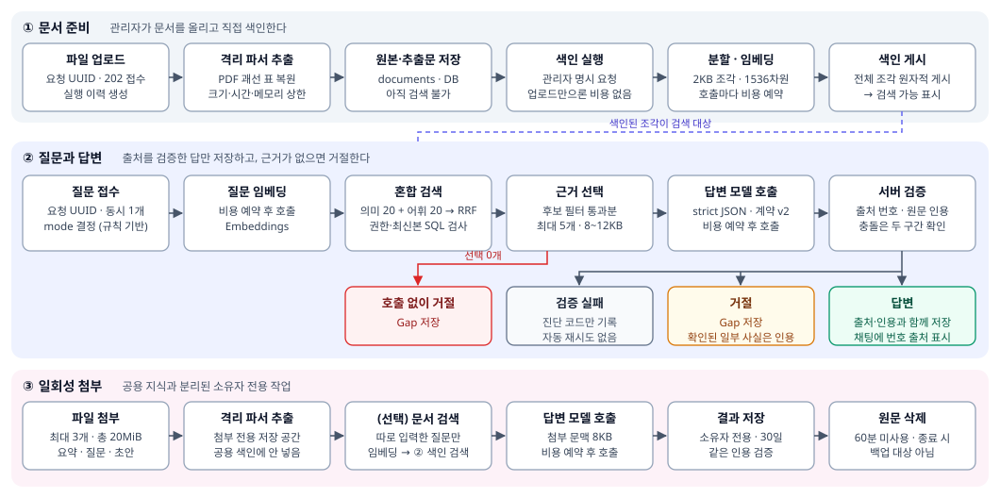

# Workspace Knowledge Agent

조직이 직접 올린 문서만 근거로 **출처가 있는 답변**을 만드는 local-first·self-hosted 오픈소스 지식 Agent다. 근거가 부족하면 추측하지 않고 거절하며, 답하지 못한 질문은 Knowledge Gap으로 남긴다.

> 프로젝트·패키지 이름은 `townbase`를 사용한다. 제품 방향은 `Workspace Knowledge Agent`로 정의되어 있다.

## 현재 상태 (2026-11-17)

| 구분 | 상태 |
| --- | --- |
| v0.2 기본 기능 | Docker 배포·단일 관리자 인증/복구·모델/전송/비용 설정·파일 등록/명시 색인·출처 답변/거절/Gap·일회성 첨부·채팅/설정/문서 웹·수동 암호화 백업/복원을 구현해 `main`에 병합했다(PR #34~#48). |
| 첫 도입 후 품질 개선 | 실제 공고 PDF로 측정한 문제를 R01~R07 단계로 보완 중이다(PR #49~#61 병합). 15문항 체감 점수는 9/30에서 23/30까지 올랐다([평가와 개선 이력](docs/evaluation/evaluation-history.md)). |
| 진행 중 (로컬, 미병합) | 점수 기준 사전 판정을 없애고 답변 가능 여부를 모델 판단에 맡기는 변경(`codex/v02-rag-model-answerability`). 실계정 회귀 평가 전이며, 구현 기록은 병합 때 함께 추가한다. |
| 이전 버전 | v0.1의 MCP 기반 구조에서 자체 Agent 기반으로 전환했다([버전 이력](#버전-이력)). |

기준 문서는 [PRD v0.2](PRD_v0_2_self_hosted_agent.md)·[TASK v0.2](TASK_v0_2_self_hosted_agent.md)·[결정 기록](DECISIONS_v0_2_basic.md)이다. 단계별 구현·검증 기록은 [docs/implementation](docs/implementation)에 있다.

## 프로젝트 개요

범용 사내 검색 AI나 Notion AI 대체재가 아니다. 다음 질문에 집중한다.

- 처음 온 사람은 무엇부터 읽어야 하는가?
- 이 정책이나 구조는 왜 이렇게 결정되었는가?
- 답에 필요한 문서는 어디에 있는가?
- 아직 문서화되지 않아 답할 수 없는 질문은 무엇인가?

한 설치는 한 조직 또는 개인이 직접 운영한다. 외부 SaaS가 아니지만, 임베딩·답변을 위해 관리자가 허용한 모델 공급자(OpenAI)로는 데이터가 전송된다. 전송은 호출 전에 설정·정책·예산으로 검사한다.

## 만들게 된 배경

지식은 Notion, README, ADR, PRD, 공고문·규정 PDF 같은 여러 장소에 흩어진다. 신규 인원은 어디서부터 읽어야 할지 모르고, 기존 인원도 과거 결정의 이유를 다시 찾는 데 시간을 쓴다.

그래서 단순 검색에서 멈추지 않는다. 질문 목적에 맞는 문서를 우선 찾고, 답변의 사실마다 원문 인용을 붙이며, 근거가 부족하면 그럴듯한 답 대신 거절과 Gap을 남긴다.

## 버전 이력

### v0.1 — MCP 기반 검색 도구 (2026-08)

Notion root page와 선택한 로컬 Git 저장소에서 README·ADR·PRD·schema 같은 문서를 수집해 pgvector에 색인하고, MCP 서버로 출처 패킷을 제공했다. 실제 답변 문장은 ChatGPT·Codex 같은 **외부 MCP Client의 Agent**가 만들었고, 서버의 기본 completion은 빈 답변을 반환하는 scaffold였다. 인증 없이 환경 변수로 설정하는 개발자용 로컬 실행이었다.

### v0.2 — 자체 Agent 기반 답변 (2026-10~)

답변 생성을 서버 안으로 옮겨, 설치한 제품이 직접 검색·답변·출처 검증·거절을 처리하도록 바꿨다. 이유는 다음과 같다.

- **답변 품질을 제품이 책임질 수 없었다.** v0.1 평가에서 최종 답변은 23/23이 맞았지만, 검색 근거만으로 정답 문서를 찾은 문항은 17/23이었다. 나머지는 외부 Agent가 이전 대화 문맥으로 보완한 결과라, 같은 질문도 사용자·Client에 따라 답이 달라졌다.
- **출처 기반 원칙을 강제할 수 없었다.** 외부 Agent가 출처 패킷을 어떻게 쓰는지, 근거가 없을 때 거절하는지 서버가 확인할 방법이 없었다. 지금은 서버가 모든 사실의 원문 인용을 검증하고, 실패하면 결과를 저장하지 않는다.
- **개발자가 아니면 쓰기 어려웠다.** MCP Client 설정과 환경 변수 편집이 필요했다. 지금은 관리자 한 명이 Docker로 설치하고 웹에서 문서 등록·질문·출처 확인을 끝낼 수 있다.
- **접근·비용·전송을 통제할 수 없었다.** 인증이 없었고 모델 호출 비용과 외부 전송 범위를 제품이 관리하지 않았다. 지금은 관리자 인증, 호출 전 전송 정책·예산 검사와 비용 예약을 거친다.

v0.1의 retrieval mode·메타데이터·출처 기반 원칙은 그대로 이어받았다. Notion/로컬 Git 수집과 MCP 코드는 `legacy_development` 프로필의 개발 경로로만 남아 있으며, 운영 배포에서는 실행을 거절한다. v0.1 범위와 결정은 [PRD v0.1](PRD_v0_1_retrieval_modes.md)·[TASK v0.1](TASK_v0_1_retrieval_modes.md)에 보관한다.

## 메인 아이디어

### 1. 질문 목적에 맞는 retrieval mode

retrieval mode는 UI 라벨이 아니라 출처 선택·prompt 전략·답변 형식에 모두 영향을 준다.

| 모드 | 질문 목적 | 답변의 중심 |
| --- | --- | --- |
| `auto` | 질문 의도 자동 판단 | 규칙 기반으로 아래 모드 선택 |
| `onboarding` | 처음 배우기 | 핵심 개념, 학습 순서, 먼저 볼 문서 |
| `product_history` | 결정의 배경 이해 | 현재 상태, 변경 이유, 관련 ADR/PRD |
| `documentation_gap` | 부족한 문서 찾기 | 반복 질문, 낮은 근거, 작성 우선순위 |

`change_impact`는 향후 확장용 예약 모드다.

### 2. 검증 가능한 출처 답변 (RAG 답변 계약 v2)

- 모델은 strict JSON schema로 답하고, 서버가 모든 사실의 출처 번호(S1~S5)와 **원문 인용**을 다시 검증한다. 인용은 원문과 연속해 같아야 하며 공백 차이만 허용한다. 저장 재조회는 정확 일치로 다시 확인한다.
- 근거에 일부만 있으면 확인된 사실만 인용과 함께 말하고 나머지는 거절·Gap으로 남긴다. 사용자가 직접 확인할 항목은 `followUps`로 분리하며 사실 통로로 쓰지 않는다.
- 서로 다른 문서, 또는 같은 문서의 겹치지 않는 두 구간이 다르게 말하면 충돌로 보고 양쪽을 인용한다.
- 검증에 실패하면 공개 오류 `invalid_grounded_response`로 끝내고 허용된 진단 코드만 남긴다. 자동 유료 재시도는 없다.

## 동작 방식 (v0.2)

1. **등록**: 관리자가 웹에서 PDF·DOCX·MD·TXT 파일을 올린다. 파일은 전용 경로에 저장되고 격리된 파서 프로세스에서 추출한다(크기·시간·메모리 상한).
2. **명시 색인**: 등록만으로 임베딩하지 않는다. 관리자가 색인을 실행하면 페이지·문단·표 행 경계를 보존해 2KB 기본 조각으로 나누고 `text-embedding-3-small`(1536차원)으로 pgvector에 저장한다. 모든 조각이 성공해야 검색 가능으로 표시한다.
3. **PDF 표 복원**: PDF 괘선으로 표 격자를 만들어 표 행을 `머리글 경로: 값` 줄로 복원한다. 확신할 수 없는 표는 기존 텍스트를 쓴다.
4. **검색**: 권한·최신 버전·범위를 SQL에서 검사한 같은 후보 안에서 의미 검색 20개와 어휘 검색 20개를 따로 모아 RRF로 합친다.
5. **근거 패킷**: 최대 5개 출처를 고르고, 입력 한도의 여유분(8~12KB)에 맞춰 문장·행 단위의 연속 구간만 모델에 보낸다.
6. **답변과 Gap**: 답변 모델(`gpt-6-luna` 기본, `gpt-6.1-sol` 선택)이 v2 계약으로 답하고, 서버 검증을 통과한 결과만 소유자 대화에 저장한다. 거절은 Gap으로 저장한다.
7. **첨부**: 채팅 첨부는 공용 색인과 분리된 일회성 작업이다. 원문은 60분 뒤 삭제되고, 공용 임베딩·Gap·평가 데이터로 전파하지 않는다.
8. **생명주기와 운영**: 문서 삭제·제외·교체는 즉시 새 검색·참조와 과거 답변의 근거를 숨긴다. 정리 범위는 다르다. 삭제는 원본·추출문·색인을 정리 작업으로 물리 삭제하고 실패하면 pending으로 재시도한다. 제외는 색인만 정리하고 원본·추출문은 보존하며, 다시 포함하면 명시 색인이 필요하다. 교체는 이전 버전의 원본·추출문·색인을 24시간 유예 뒤 정리하고 최신 버전은 유지한다. 삭제 의도는 별도 journal에 먼저 기록한다. 백업은 AES-256-GCM 암호화 snapshot이다.

### 구성 아키텍처



- 웹 화면은 API가 정적 파일로 제공한다. 보호된 API 요청은 전역 인증 guard에서 세션과 설치·소유 범위를 확인한다. 공개 예외는 상태 확인(`/health`·`/readyz`·설치 상태), 최초 관리자 등록, 로그인·로그아웃, 로컬 토큰 복구뿐이다.
- 임베딩·답변 호출은 `ModelExecutionService` 한 곳을 거친다. 전송 정책·Key·예산을 확인하고 비용을 먼저 예약한 뒤 호출한다.
- 백업·복원은 API 안의 기능이 아니라 호스트에서 API를 멈추고 실행하는 운영자 명령이다.

### 동작 흐름



- 업로드만으로는 비용이 생기지 않는다. 관리자가 색인을 실행해야 검색 대상이 된다.
- 근거 후보 필터를 통과한 근거가 없으면 모델을 부르지 않고 거절한다. 근거가 있으면 답할 수 있는지는 모델이 판단하고, 서버가 인용을 검증한다. 이 분기는 진행 중인 사전 판정 전환을 반영한 것이며, 현재 `main`은 점수 기준(raw 0.45·상위 3개 평균 0.40)과 어휘 근거를 모두 못 넘으면 호출 없이 거절한다.
- 첨부 원문은 공용 색인에 들어가지 않는다. 사용자가 따로 입력한 검색 질문만 임베딩한다.

### 디렉터리 구성

```text
apps/api/              NestJS API (인증, 파일, RAG, 첨부, 운영)
apps/web/              React + Vite 웹 (채팅, 설정, 문서 관리)
packages/database/     Prisma schema, migration, runtime 프로필
packages/agent-core/   기본 Agent 계약, prompt context와 citation
packages/rag-core/     chunking, embedding, retrieval mode
packages/connectors/   v0.1 Notion·로컬 Git 수집 (legacy 개발 경로)
deployment/            Compose 준비, migration, 백업/복원, 배포 시험
docs/                  배포·백업 안내, 단계별 구현·평가 기록
```

## 기술 선택 이유

- **TypeScript + pnpm workspace**: API·웹·도메인 패키지의 계약을 타입으로 공유한다.
- **NestJS**: 인증·파일·RAG·첨부·운영의 경계를 module/service로 나누고 전역 인증 guard를 적용한다.
- **PostgreSQL + pgvector + Prisma**: 관계형 상태와 벡터 검색을 한 DB에서 관리한다. API는 열 단위로 권한을 제한한 `townbase_runtime` 계정으로 접속한다.
- **Docker Compose 단일 설치**: Redis·별도 worker·외부 클라우드 없이 API/웹·DB·일회성 migration을 함께 실행한다.
- **OpenAI Responses/Embeddings 고정**: 도입자 본인 Key로 검증된 답변 모델만 선택하게 한다. 임베딩은 small/1536으로 고정해 재색인 없이 답변 모델을 바꿀 수 있다.
- **pdf.js·Mammoth·yauzl**: 로컬 프로세스에서 PDF·DOCX를 추출하고 표 괘선 정보를 직접 읽는다.
- **React + Vite**: 별도 프레임워크 없이 채팅·설정 화면을 가볍게 제공한다.

## 주요 사용 기술

Node.js 24, TypeScript, pnpm, NestJS, React, Vite, Jest, ESLint, PostgreSQL, pgvector, Prisma, OpenAI Responses·Embeddings API, pdf.js, Mammoth, Docker Compose. v0.1 legacy 경로는 Notion API와 Model Context Protocol을 사용한다.

## 주요 결정

1. **Local-first·self-hosted를 기본으로 한다.** SaaS·멀티테넌시·외부 클라우드 배포·회원가입·다중 Agent는 범위 밖이다.
2. **근거가 없으면 답하지 않는다.** 근거가 약하면 거절하고 Gap을 남긴다. 근거 부족을 숨기는 대체 동작을 두지 않는다.
3. **사실마다 원문 인용을 서버가 검증한다.** 모델 출력은 신뢰하지 않고 출처 번호·인용·충돌 구간을 다시 확인한다.
4. **비용은 호출 전에 예약한다.** 예산·가격표·전송 정책이 확인되지 않으면 유료 호출을 막고, 같은 요청을 자동으로 다시 부르지 않는다.
5. **색인은 명시 실행이다.** 업로드만으로 비용이 생기지 않으며, 추출·색인 규칙이 바뀌어도 기존 색인을 자동 재생성하지 않는다.
6. **첨부는 공용 지식이 아니다.** 일회성 첨부는 소유자 전용 결과로만 저장하고 공용 RAG·Gap·평가로 퍼뜨리지 않는다.
7. **임베딩은 `text-embedding-3-small`·1536차원 고정이다.** 변경은 제품 업그레이드·재색인·품질 시험으로만 다룬다.

세부 수치와 승인 상태는 [DECISIONS_v0_2_basic.md](DECISIONS_v0_2_basic.md)를 따른다.

## 평가 요약

- **v0.1 MCP 평가 (2026-08-25)**: Keeply 문서 21개·23문항에서 최종 답변 23/23, RAG 검색 Hit@K 73.9%.
- **v0.2 실계정 합성 평가 (2026-11-08)**: 공개 합성 문서 두 집합·60문항×3회에서 모든 회차가 품질 기준(Hit@5·출처 정확성·판정·근거 없는 오답 0·충돌 탐지)을 충족했다. 독립·블라인드 평가는 아니다.
- **첫 실제 도입 문서 (2026-11-10~)**: 행복주택 공고 PDF 15문항 체감 점수가 9/30에서 23/30으로 올랐다. 검색·근거 전달·표 추출·인용 검증을 단계적으로 보완했고, 일부 문항과 거절 회귀 확인이 남아 있다.

평가 조건·수치·문제별 원인과 대응은 [평가와 개선 이력](docs/evaluation/evaluation-history.md)에 모아 둔다.

## 실행

Docker와 Compose plugin이 필요하다. 아래 준비 명령에는 Node.js가 필요하며, Node가 없는 호스트는 [컨테이너 준비 대안](docs/self-hosted-deployment.md#1-첫-실행)을 사용한다. 기존 v0.1 DB volume은 자동 재사용하지 않는다. 설치마다 고유한 Compose 프로젝트 이름을 정하고 이후에도 같은 이름을 사용한다.

```bash
node deployment/prepare.mjs
if [ ! -e .townbase/compose.env ]; then
  printf 'TOWNBASE_PORT=3000\n' > .townbase/compose.env
fi
docker compose --env-file .townbase/compose.env -p my-townbase up -d --build --wait --wait-timeout 180
```

기본 주소는 `http://127.0.0.1:3000`이다. `TOWNBASE_PORT`를 바꿨다면 해당 포트를 사용한다. 실제 게시 주소는 아래 명령으로 확인한다. 이후 모든 Compose 명령에 같은 `--env-file`과 `-p`를 사용한다. DB 포트는 외부에 열리지 않는다.

```bash
docker compose --env-file .townbase/compose.env -p my-townbase port api 3000
```

첫 사용 순서:

1. [보호된 로컬 토큰](docs/self-hosted-deployment.md#7-최초-관리자-등록-b03)으로 최초 관리자를 등록하고 로그인한다.
2. 설정에서 OpenAI Key·외부 전송 정책·월 예산을 저장하고 연결을 확인한다. Key·예산·가격표·전송 허용 전에는 유료 호출이 차단된다.
3. 문서 메뉴에서 파일을 올리고 **색인**을 실행한다.
4. 기본 Agent의 목적·지침·참조 문서를 정하고 채팅에서 질문한다.

외부 접속/TLS와 오류 복구는 [배포 안내](docs/self-hosted-deployment.md), 백업·복원은 [백업/복원 안내](docs/backup-and-restore.md)를 따른다.

### 개발과 시험

```bash
pnpm install
pnpm build
pnpm lint
pnpm test
pnpm test:deployment
```

실제 DB를 쓰는 통합 시험은 단계별 opt-in 환경 변수와 전용 시험 DB에서만 실행한다. 일반 `pnpm test`는 이를 건너뛰며 실제 Key·유료 호출을 사용하지 않는다. 조건은 [AGENTS.md](AGENTS.md)와 각 구현 기록을 따른다.

## 한계와 향후 개선

- 단일 관리자만 지원한다. 회원가입·그룹/문서별 권한·다중 Agent는 없다.
- 예약 동기화·Notion/Slack 같은 운영용 connector는 없다. 문서는 파일로 올린다.
- OCR, 비괘선 표 복원, 토큰 스트리밍은 없다.
- 답변 품질 수치는 공개 합성 문서와 단일 실제 공고 PDF 기준이다. 독립·블라인드 평가와 대규모 자료 검증은 아직 없다.
- 추출·색인 규칙이 바뀌면 기존 문서는 관리자가 직접 재처리·재색인해야 한다(유료 임베딩).

남은 평가·품질 작업은 [평가와 개선 이력](docs/evaluation/evaluation-history.md#남은-확인)을 따른다.

## 라이선스

이 프로젝트는 [MIT License](LICENSE)로 배포한다.
