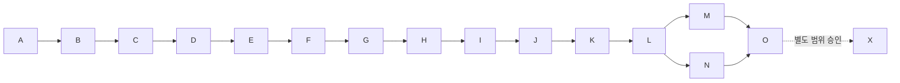

> 보관 문서: 2026-10-22 기본 TASK 재작성 직전 원문. 현재 실행 기준이 아니다.
> 현재 기준: [기본 TASK](TASK_v0_2_self_hosted_agent.md). 과거 작업 ID를 새 작업의 완료 근거로 사용하지 않는다.

# Workspace Knowledge Agent v0.2 — 상세 TASK 및 단계별 완료 기준

> 작성일: 2026-10-21  
> 작성 당시 기준: [범위 축소 전 PRD](PRD_v0_2_full_scope_reference.md)와 해당 문서 9.5의 당시 사용자 확정 정책  
> 상태: 이전 범위의 구현 계획 초안. 2026-10-22 [현재 PRD](PRD_v0_2_self_hosted_agent.md)를 기본 기능 중심으로 축소했으므로, 아래 전체 작업·선행 관계·완료 기준은 재작성 전 실행 기준으로 사용하지 않는다. 체크되지 않은 작업은 미완료이며 추천 기술·수치는 승인된 기본값이 아니다.  
> 후속 정리: 메일·직원 가입·Drive·예약 등 추가 기능의 필수 선행 관계를 제거하고 일회성 첨부는 기본에 유지한다. 본문은 과거 계획 보존용이며 이번 PRD 수정에서 전체 TASK를 재작성한 것은 아니다.

## 0. 문서 사용법과 범위

이 문서는 현재 RAG 엔진을 조직별 설치형 제품으로 확장하는 순서, 단계별 작업, 선행 조건, 설정값, 종료 조건을 정의한다. 현재 코드가 있는 기능도 v0.2의 권한·저장·전송 정책을 만족하는지 다시 검증한다.

개별 구현 작업은 `V02-A01` 형식으로 식별하고 기본 상태는 모두 ‘미착수’다. PRD 결정 ID `D01`과 설정 ID `S01`은 작업 ID와 구분한다.

### 0.1 확정값과 미정값의 구분

| 표시 | 의미 | 구현 시 처리 |
| --- | --- | --- |
| 확정 | 사용자가 승인한 제품 정책 | 관련 TASK에서 반드시 준수 |
| 기존 기준 | 현재 코드에 있는 값·구조 | 회귀 비교에 사용. 제품의 최종 기본값으로 자동 승인하지 않음 |
| 추천·미정 | 이 문서가 제안하는 기술·수치 | 해당 단계 착수 전에 승인·변경 내용을 결정 기록에 남김 |
| 설치 시 입력 | 조직별로 다른 비밀값·주소·도메인 | 예시를 실제 값으로 하드코딩하지 않음 |

- 구현자는 미정 정책에 임의 기본값을 적용하지 않는다. 의존하지 않는 문서·계약 작업은 먼저 진행할 수 있지만 해당 정책에 의존하는 코드·migration은 결정 후 착수한다.
- 비밀 Key·OAuth secret·실제 사내 문서·직원 주소는 이 문서나 Git에 기록하지 않는다.
- 루트 AGENTS.md가 아직 v0.1 문서를 기준으로 하므로 A 단계에서 v0.2 구현의 적용 범위를 명시한다. 기존 v0.1 PRD/TASK는 과거 구현·평가 기록으로 유지한다.
- 본 문서 작성은 문서 작업이다. 이후 코드 구현은 별도 브랜치에서 수행하고, 구현 요약 후 사용자 승인에 따라 commit → push → main 대상 PR을 진행한다.
- ‘기술 검증 완료’와 ‘저장소 전달 완료’를 구분한다. 기술 검증을 통과해도 요구된 commit·push·PR이 승인·수행되기 전에는 최종 전달 완료로 표시하지 않는다.

### 0.2 변경하지 않는 제품 원칙

1. 한 조직이 독립 설치하는 self-hosted 오픈소스 제품. SaaS 과금·멀티테넌시·중앙 호스팅은 제외.
2. RAG에 지속 등록할 자료는 관리자만 설정에서 관리. 초기 색인은 전 직원 공용 문서만 포함.
3. 일회성 첨부 작업은 허용하되 첨부·추출문·요약·답변이 자동 임베딩·공용 색인·공유 Gap·draft로 전파되지 않음.
4. 답변 공급자는 ChatGPT 계열(OpenAI)·Claude·Gemini·Grok 네 곳. 임베딩 모델은 별도 결정. 임의 endpoint·로컬 답변 모델은 초기 비범위.
5. 가입은 명시한 도메인 + 실제 이메일 인증 + 관리자 승인. 관리자와 발송용 메일 계정은 별도 관리 가능.
6. 메일 발송은 Gmail API·Microsoft Graph 기본, 기존 SMTP 대체. 새 메일 서버나 유료 발송 서비스 가입은 필수 아님.
7. 관리자 설정 주기의 정기 실행, 수동 실행, 수행자·실행 이유·변경 문서가 남는 영속 이력 제공.
8. 지원 Docker 환경에서 `docker compose up -d` 한 번으로 앱·DB·migration·첫 설정 화면 시작. 회사별 인증·Key 설정은 웹에서 진행.
9. 근거 부족은 거절·Knowledge Gap으로 처리. 모델 오류·권한 불명·전송 불허를 조용한 fallback으로 숨기지 않음.

### 0.3 범위를 나눈 완료 지점

| 완료 지점 | 포함 범위 | 의미 |
| --- | --- | --- |
| 초기 웹 제품 | A~L | 최초 설치·가입·관리자 수집·독립 Q&A·첨부·동기화·복구를 검증한 시범 운영 가능 상태 |
| 채널 확장 | M | 초기 웹 제품에 Slack 멘션·정책을 적용한 MCP 연결 추가 |
| 문서 초기 확장 | N | SharePoint·OneDrive 추가. Microsoft 메일 발송은 D에서 이미 구현 |
| v0.2 전체 완료 | O | A~N의 통합 검증·문서·시범 운영과 저장소 전달 완료 |
| 후속 계획 | X | Confluence·표·대화 이력·IAM·보안 고도화. v0.2 전체 완료에 포함하지 않음 |

Slack·Microsoft 365를 뒤 단계에 두는 것은 요구사항을 삭제하는 것이 아니다. 초기 웹 제품과 v0.2 전체 종료를 구분해 작은 단위로 검증한다.

## 1. 현재 구현에서 재사용할 부분과 공백

| 기존 경로 | 재사용·수정 방향 |
| --- | --- |
| `apps/api/src/chat/` | 검색·출처 패킷·질문 저장을 재사용. 실제 completion, 사용자 맥락, 전송 통제 추가 |
| `apps/api/src/ingestion/` | 수동 호출을 관리자 인증으로 보호. CLI stdout 파싱 중심 실행을 구조화된 실행·문서별 결과 계약으로 보완 |
| `apps/api/src/knowledge-gaps/` | Gap·draft 영속화 재사용. 소유자·공유 검토·첨부 오염 방지·접근 검사 추가 |
| `packages/connectors/src/` | Notion·로컬 Git·메타데이터 재사용. DB 연결 설정, 공통 sync 계약, 파일·Drive adapter 추가 |
| `packages/rag-core/src/` | 분할·임베딩·mode 계약 재사용. 운영용 fake fallback 차단·모델 설정 일원화 |
| `packages/agent-core/src/` | context·prompt·citation 재사용. 근거 본문 포함·주장/출처 연결·첨부 구분 검증 |
| `packages/database/prisma/` | 기존 Workspace·Document·Chunk·Question·Gap·Draft 유지. 계정·정책·연동·실행·대화·첨부·감사 확장 |
| `docker-compose.yml` | 현재 DB만 실행. secret 초기화·migration·API·웹·상태 점검을 포함하도록 확장 |
| `package.json`·패키지별 `package.json` | 현재 script부터 회귀 확인. production에서 빌드 산출물로 실행되게 `main`·`types`·의존성 확인 |
| 웹 앱 | 현재 없음. `apps/web/` 신규 구성을 추천하되 프레임워크는 S02 승인 후 확정 |

기존 기준은 chunk `600 tokens / overlap 80`, 질문 `topK=5`·최대 `50`, 답변 가능 판정 top score `0.45`·상위 3개 평균 `0.40`, 기본 검색 `vector_only`, 임베딩 `1536차원`이다. 이 값들은 현재 구현 관측값이며 신규 조직에서 품질을 보장하는 수치가 아니다.

## 2. 전체 선행 관계와 우선순위

### 2.1 단계 순서

| 단계 | 우선순위 | 반드시 끝나야 할 선행 단계 | 담당 영역·최종 산출물 |
| --- | --- | --- | --- |
| A | P0 | 없음 | 현재 상태·정책·설정값 승인 기록과 검증 범위 |
| B | P0 | A | DB·secret·감사·실행 기반과 최소 배포 |
| C | P0 | B | 안전한 최초 관리자·세션·기본 Role·초기 웹 화면 |
| D | P0 | C | 기존 메일 연결·가입·인증·승인·탈퇴 |
| E | P0 | D | 연동 관리·외부 전송 정책·네 답변 공급자·임베딩 adapter |
| F | P0 | E | DB 기반 동기화 실행·일정·문서별 이력 계약 |
| G | P0 | F | 파일·폴더·Notion·Git·Drive 수집·색인 |
| H | P0 | G | 독립 답변·Agent·개인 대화·출처·Gap |
| I | P0 | H | RAG와 분리된 일회성 첨부 작업 |
| J | P0 | I | 전체 첫 설정·채팅·관리·동기화 UI 완성 |
| K | P0 | J | 보관·삭제·복구·배포·보안 운영 검증 |
| L | P0 | K | 초기 웹 제품의 통합 평가·시범 운영 gate |
| M | P1 | L | Slack 멘션·계정 매핑·승인 MCP |
| N | P1 | L | SharePoint·OneDrive 문서 Connector |
| O | P1 | M, N | v0.2 전체 수락·운영 문서·전달 |
| X | 후속 | O 및 별도 범위 확정 | 차기 확장 설계. 자동 착수하지 않음 |

표는 가장 보수적인 순차 실행 기준이다. M과 N은 서로 선행하지 않는다. 한 명이 작업한다면 M → N을 추천한다. UI는 C부터 각 기능과 함께 만들고 J는 통합 완성 단계로 둔다. 보안·삭제 데이터 구조도 B부터 적용하며 K까지 미루지 않는다.

단계 안의 TASK 표도 위에서 아래가 기본 수행 순서다. 같은 단계의 독립 화면·fixture 준비는 먼저 할 수 있지만, 실제 외부 호출·데이터 migration은 필요한 설정 승인과 앞선 계약·권한 구현을 끝낸 뒤 수행한다. 한 단계의 일부 TASK 성공을 단계 전체 통과로 표시하지 않는다.



### 2.2 모든 단계에 공통으로 필요한 종료 증거

- 관련 설정·생성 결과를 실제 DB·파일에 저장하고, 요청·프로세스·세션을 바꿔 재조회한다.
- 관리자·일반·미인증·비활성 계정의 직접 API 요청으로 접근을 검증한다. 화면 숨김만으로 통과하지 않는다.
- 정상 경로와 중요한 실패·재시작·재시도·중복 요청을 검증한다. 외부 연결은 fixture 통과와 실제 연결 통과를 구분한다.
- 문서 ID·실행 ID·기록·화면 등 증거를 남기되 Key·메일 코드·사내 원문을 증거 파일에 노출하지 않는다.
- 단계 보고서에 적용값·승인 기록·변경 파일·실행 명령·결과·남은 제한을 남긴다. 권장 경로는 `docs/v0.2/evidence/<stage>/`이며 아직 생성된 경로는 아니다.
- 의미 있는 계약·통합·실제 시나리오 위주로 확인한다. 문구 변경이나 구현을 그대로 복제하는 테스트를 불필요하게 늘리지 않는다.
- 코드 단계는 요약과 사용자 승인 후 commit·push·main PR까지 추적한다. 기능 gate와 저장소 전달 상태를 각각 기록한다.

## 3. 설정값 목록 — 추천안, 아직 미승인인 값

아래 S01~S28은 PRD의 D01~D14를 실행 가능한 값으로 바꾼 제안이다. 사용자 확정 정책을 바꾸지 않는다. 숫자와 신규 기술 선택은 모두 추천·미정이며, A에서 관련 승인 상태를 기록한다. 구현 시 항목별 유효 범위와 단위를 검증한다.

### 3.1 실행·초기 설정·계정

| 설정 ID | 추천값·방향 | 설정 주체·결정 시점 |
| --- | --- | --- |
| S01 실행 환경 | 최초 운영 검증 Linux x86_64·Ubuntu 24.04 LTS, ARM64·macOS·Windows Docker 환경은 O 전 지원 행렬로 검증. 앱 기준 시험 장비 4 vCPU·8 GiB RAM·40 GiB 여유 디스크. 외부 모델 호출 구성이므로 GPU 필수 아님 | D01·D14 / A. 최소 사양 보장 전 L 실측 필요 |
| S02 웹·앱 구조 | 기존 NestJS·pnpm·Prisma·PostgreSQL 유지. 웹은 React·TypeScript·Vite SPA, API와 같은 origin. package·라이브러리 버전은 A에서 지원 버전 확인 후 lockfile 고정 | 기술 미정 / A. Next.js 대안은 SSR 필요가 확인될 때 |
| S03 secret 저장 | AES-256-GCM, 32-byte 무작위 master key·버전 식별. DB와 별도 secret volume, 일반 컨테이너 미마운트, 파일 권한 0600. IV 재사용 금지·인증 실패 시 복호화 중단 | D08 / B 전. 세부 암호화 구현은 검증된 라이브러리 사용 |
| S04 bootstrap | 32-byte 무작위 일회성 토큰, 60분 만료, 첫 관리자 생성은 DB 제약으로 1회. 제한된 bootstrap 세션으로 메일 설정만 수행. 만료 시 서버 운영자가 로컬 명령으로 재발급 | D08 / C 전. 토큰은 UI·일반 로그에 남기지 않음 |
| S05 비밀번호·세션 | 비밀번호 15~128자, Unicode 허용·강제 조합 규칙 없음. Argon2id 시작값 19 MiB·iterations 2·parallelism 1. 세션 토큰 32 bytes, DB에는 hash. 절대 8시간·비활성 30분 만료, 중요 설정 재인증 5분 이내 | D08 / C 전. 서버 성능·계정 정책 검증 후 조정 |
| S06 메일 코드·요청 제한 | 코드 8자리·10분·최대 검증 5회, 재전송 최소 60초·수신자당 15분 5회·IP당 15분 100회. 서버 비밀키 기반 HMAC에 계정·purpose·challenge ID를 결합해 코드 검증값 저장. 비밀번호 재설정 토큰 32 bytes·15분·1회. 로그인 실패 계정당 15분 10회 후 점진 지연 | D08 / D 전. NAT 환경 오차·우회 시험 필요 |
| S07 OAuth·SMTP | OAuth state·연결 증명 10분·1회, PKCE 지원 공식 라이브러리 사용. Gmail 발송 `gmail.send`, Microsoft delegated `Mail.Send` 등 최소 범위. SMTP 기본 제안 587+STARTTLS·인증서 검증 강제, 465 implicit TLS 선택 지원 | D03·D08 / D·G 전. 실제 scope·tenant·redirect URI는 조직별 입력 |

OWASP는 Argon2id의 위 시작 설정과 긴 비밀번호·안전한 업로드 원칙을 안내한다. 적용값의 성능·사용성은 제품에서 따로 검증한다. 출처는 23절 참조.

### 3.2 자료·동기화·검색·모델

| 설정 ID | 추천값·방향 | 설정 주체·결정 시점 |
| --- | --- | --- |
| S08 파일 한도 | 관리자 RAG 등록 파일당 20 MiB. 일회성 첨부 파일당 10 MiB·최대 3개·합계 20 MiB. 두 경로 모두 PDF/DOCX/MD/TXT. 초기 배치 업로드 최대 50개 | D09 / G·I 전. provider context 한도는 별도 적용 |
| S09 추출 제한 | 파일당 처리 30초·추출 text 30만 Unicode code points·파서 메모리 512 MiB. DOCX 압축 해제 합계 100 MiB·entry 1,000개·비율 100배 상한. 초과는 명시 실패, 자동 잘라내기 금지 | D09 / G 전. 파서별 검증 후 확정 |
| S10 원본·문서 | 소스별 `(sourceId, externalId)` 유일. hash는 SHA-256. 원본 출처·접근 상태 독립 유지, 같은 내용만으로 서로 다른 원본 병합 금지. 공유 드라이브·하위 폴더·파일 scope를 명시 선택 | D03·D09 / F·G 전. Drive OAuth 앱은 조직 소유를 추천 |
| S11 동기화 주기 | 첫 설정에서 관리자가 명시 선택. 추천 매일 02:00, 선택지 수동만·1시간·6시간·매일·매주. 시간대는 IANA 식별자, 브라우저 값을 제안하되 관리자가 확인. DB 시각은 UTC | D10 / F 전. ‘매일’ 자동 활성화하지 않음 |
| S12 실행 제어 | 단일 API 내 DB 작업 실행, scheduler poll 30초·heartbeat 30초·lease 120초, 전체 sync timeout 2시간. 소스당 동시 1개·설치 전체 수집 1개. 같은 범위 중복은 기존 실행 ID 반환, 다른 범위는 대기 | D10 / F 전. 별도 worker·Redis 없이 시작 |
| S13 재시도·최신성 | 전체 최대 3회 시도, 대기 30초·120초+jitter·Retry-After 우선. 15분 넘는 대기는 실행 lease를 붙잡지 않고 예약 재시도로 이월하되 Retry-After보다 일찍 재요청하지 않음. 놓친 일정은 최신화 1회로 병합. 접근 미확인 즉시 검색 보류, 정상 권한 확인 유효기간 후보 24시간 | D10 / F·G 전. 짧은 갱신이 필요한 소스는 유효기간도 함께 조정 |
| S14 검색 기준 | 현행 600/80 token·topK 5·최대 50·vector_only·0.45/0.40 threshold를 baseline으로 유지. 신규 조직 Golden Dataset으로 보정 후 제품 기본값 확정. 숫자만 낮춰 빈 근거를 통과시키지 않음 | 기존 기준 / H·L. mode 전략은 계약 유지, 변경은 별도 실험 |
| S15 모델 | 네 답변 공급자 각각 공식 API adapter와 검증한 안정 모델 ID 1개부터. provider별 실제 ID는 E 전 공식 문서·가용성·시험 후 확정. 임베딩 추천은 현행 `text-embedding-3-small`·1536차원 재사용 | D02 / E 전. 임베딩 추천도 미승인. 기존 모델명으로 공급자 전체 지원을 가정하지 않음 |
| S16 context | 사용자 질문 최대 4,000자, 답변 context 입력 예산 16,000 tokens·출력 최대 2,048 tokens. RAG 근거 최대 8,000·첨부 추출 합계 최대 8,000을 전체 예산 안에서 조정. 대화 최근 최대 10턴도 전체 예산에 포함 | D12 / H·I 전. 모델 최대치가 더 작으면 더 작은 값 적용. 초과 안내·재선택, 조용한 손실 금지 |
| S17 요청·timeout | 일반 질문 계정당 분당 10회·동시 1개, 설치 답변 동시 4개·대기 최대 20개. provider 연결 10초·전체 응답 90초. 클라이언트 종료 이후 정책 확인 없이 계속 전송하지 않음 | D12 / E·H 전. 수집·추출은 별도 제한 |
| S18 비용 | 유료 호출 전 관리자가 월 예산과 공급자별 가격표 버전을 입력·확인. 시험 예산 후보 설치당 US$20/월, 알림 80%·100%에서 신규 호출 중지. 가격 미확인은 0원 처리 금지 | D12 / E 전. 추정·예약 usage 기준의 제품 한도이며 공급자 청구액 보장 아님. 숫자는 조직이 선택 |

### 3.3 보관·채널·운영·검증

| 설정 ID | 추천값·방향 | 설정 주체·결정 시점 |
| --- | --- | --- |
| S19 보관 | 개인 대화·질문 30일, sync·문서별 이력 90일, 감사 90일, 비밀값 없는 진단 로그 7일. 임시 첨부는 작업 종료 즉시 삭제. 실패/미사용은 60분에 접근 만료·다음 cleanup 5분 내 물리 삭제. 첨부 기반 답변은 개인 대화 정책 적용하되 재임베딩 금지 | D07 / B·I·K 전. 공유 승인 Gap·draft는 해결 후 90일 후보 |
| S20 삭제 | 삭제 요청·연결 해제 즉시 검색/전송 중지, 원문·벡터·파생 기록 정리는 24시간 안. 백업은 최대 7일 내 만료, 복원 시 삭제 tombstone을 반영하기 전 서비스 공개 금지 | D07 / B·K 전. 법적 보관 요구는 조직 정책으로 별도 결정 |
| S21 백업 | 매일 03:00·7개 일간 세대, DB·문서 파일·설정 암호화 백업과 분리 master key 복구. RPO 24시간·RTO 4시간 후보. 배포 전 수동 snapshot, migration 실패 시 이전 DB+파일 함께 복원 | D14 / K 전. 시간대 S11 적용·복구 실측 전 보장 금지 |
| S22 Slack | 최초 Socket Mode 추천. 제품 로그인과 Slack OAuth를 결합해 사용자 연결, 연결 state 10분·1회. 승인 내부 채널만, 외부 공유 채널·게스트 제외 추천. 수신 확인 3초 이내, event 중복 기록 7일·연결 재검증 | D11 / M 전. 채널·identity 권한·정확한 scope 확정 필요 |
| S23 MCP | 초기 stdio 유지, 제품에서 발급한 사용자/운영 서비스 자격 증명 hash 저장·30일 만료·즉시 철회. 사용자 없는 연결은 승인한 공용 소스만·기본 읽기. 원격 MCP transport는 초기 필수 아님 | D11 / M 전. 관리 기능은 별도 scope로 기본 미부여 |
| S24 네트워크 | 기본 진입 `127.0.0.1:3000`, DB 포트 외부 미공개. 사내 공개 시 HTTPS와 명시적 origin 필수. Secure·HttpOnly·SameSite=Lax cookie, CSRF token/Origin 검증. 접속 주소·인증서는 조직 입력 | D01·D08 / B·C·J 전. HTTP 사내 공개로 인증 우회 금지 |
| S25 대기·화면 | sync 상세 polling 5초, 목록 25개/페이지·최대 100. 기본 HTTP 요청 30초, 장기 작업은 202+실행 ID. 답변은 request ID 기반 상태 조회 또는 SSE 추천 | D10·D12 / F·H·J 전. 실제 응답 전송 방식은 H 승인 |
| S26 전송·격리 | 신규 연결은 용도별 외부 전송 미허용. common-source 확인+임베딩/답변/Slack/MCP 각각 승인 후 사용. 의심 문서는 자동 마스킹 전송 대신 격리, 재검토 원문은 해당 관리자만 열람 | D06 / B·E·G 전. 검사 범위·격리 보관 기간은 아래 미정표 |
| S27 시험 규모·성능 | 50명 등록·동시 질문 4개·문서 1,000개·chunk 약 10,000개 후보. 조직별 독립 세트 60문항 이상·최소 2개 corpus. 검색 context p95≤2초(질문 임베딩·provider 제외), 최종 응답 p95≤45초 후보 | D14 / A 초안·L/O 실측. 장비·모델·길이·동시성 고정 후 판단 |
| S28 품질 | corpus별 Hit@5≥90%, 출처 정확성≥95%, 답변 가능 판정≥90%, 근거 없음 오답 허용≤5% 후보. 지정 권한·유출·첨부 미색인·복구 테스트 실패 0개 | D14 / A 초안·L/O 검증. 보안 시험 통과를 유출 0의 보장으로 표현하지 않음 |

S24의 loopback은 초기 접근을 위한 기본 바인딩이다. 사내 공개와 일반 로그인 세션·OAuth를 운영할 URL/TLS는 B·C에서 먼저 결정한다. 로컬 개발 HTTP 예외는 개발 모드·loopback으로 제한하고 production의 Secure cookie나 origin 검사를 자동 해제하는 fallback을 두지 않는다.

### 3.4 별도 승인이 필요한 항목과 추천 대안

| 미정 항목 | 추천안 | 대안·선택 조건 | 미결정 시 막히는 작업 |
| --- | --- | --- | --- |
| 웹 기술·배포 지원 행렬 | S01·S02, Linux 우선 검증 후 ARM64 등 추가 | 다른 UI 프레임워크·첫 도입 OS 우선 지원 | B의 이미지 설계·C UI |
| 실제 네 답변 모델 ID | 공급자별 안정·일반 텍스트 모델 중 비용/품질 시험 통과 1개, alias보다 검증 버전 식별 | 고성능 모델 선택 시 비용·context·속도 재측정 | E adapter live gate·H |
| 임베딩 | 현행 모델·1536차원 | 허용 공급자의 다른 임베딩은 차원·schema·전체 재색인·품질 비교 포함 | E·G·H의 실제 색인/검색 |
| Drive 인증·scope | 조직 OAuth 앱·수집 계정·명시 소스 범위, 필요한 읽기 권한 | 조직이 관리 가능한 서비스 계정. 전사 위임은 초기 기본 아님 | G Drive 실제 연결 |
| Google/Microsoft 발송 앱 등록 | 조직 소유 앱, 발송 전용 delegated 권한 | 별도 mail account·기존 SMTP. 사용자 Role로 발송 권한 대체 불가 | D 실제 메일·전체 onboarding |
| master key·복구 | S03, 운영자가 별도 백업·로컬 복구 | 회사 secret 관리 서비스가 있으면 연동 검토 | B·D의 실비밀 저장 |
| 코드·세션·요청 제한 | S04~S07 | 조직 보안 기준이 더 강하면 조정, 이메일 인증 자체 생략 불가 | C·D |
| 파일·추출·첨부 보관 | S08·S09·S19 | 더 큰 파일은 자원·context·실패 정책 검증 후 상향 | G·I |
| 비밀값 검사 범위 | private key, 명시 토큰 패턴, 비밀 설정 파일 차단+관리자 공용 확인. 의심 문서 7일 격리 후 삭제 후보 | 일반 개인정보·기밀 의미 분류는 후속 DLP. 외부 서비스에 원문 보내 검사하지 않음 | E·G·I 실제 외부 전송 |
| 일시 장애·권한 신선도 | 접근 미확인 즉시 검색 보류, 24시간 유효 후보·상태 확인 후 복원 | 더 짧은 유효기간은 주기·API 비용도 조정. 장애를 삭제 증거로 사용 불가 | F·G·H |
| 일정·재시도·동시 실행 | S11~S13 | 다른 주기 선택지·요청 대기는 운영 수요로 결정 | F |
| 대화 삭제·첨부 파생 답변 | 개인 30일·첨부 원문 즉시 삭제·파생 텍스트는 개인 기록만. 해당 기록을 후속 검색 질의/공유에 사용 금지 | 첨부 파생 답변도 저장하지 않는 엄격 구성 | H·I·K |
| 운영 한도·비용값 | S16~S18, 최초 setup에서 예산 명시 | 사용량 상한만 가능한 공급자는 추정 비용 한계 표시 | E·H·L |
| Slack·MCP 인증 | S22·S23 | HTTP 이벤트·원격 MCP는 별도 운영 필요 시 | M |
| Microsoft 문서 scope | N의 site/library/folder 제한 읽기 | 조직 정책에 따라 application 권한 검토, 전사 읽기 기본 금지 | N |
| backup·보관·출시 수치 | S19~S21·S27·S28 | 조직 문서 규모·장비·복구 요구에 맞춰 변경 | B 데이터 구조·K·L·O |

위 표에 값이 제안돼 있어도 승인되지 않은 것은 미정이다. ‘최초 조직이 사용할 실제 도메인·Key·메일 계정·채널·예산’은 제품 개발자가 정할 값이 아니라 첫 설정에서 운영자가 입력할 값이다.

## 4. A 단계 — 기준 고정과 실행 계획 승인

**목적:** 현재 기능과 v0.2 목표를 구분하고 이후 개발이 추측에 의존하지 않게 한다.  
**최종 목표:** 단계별 착수 가능 여부와 미정값 담당·결정 시점이 명확한 기준 문서.  
**선행:** 없음. **PRD 대응:** 1.2·2·3·7·8·9. **설정:** S01~S28 승인표 작성.

| TASK | 수행 작업 | 산출물·검증 |
| --- | --- | --- |
| V02-A01 | 기존 README·PRD·TASK·코드의 실동작·설명 불일치 조사. 실제 completion·mode·임베딩 fallback·동기화 상태를 기록 | 재사용/수정/미구현 목록과 현재 실행 결과 |
| V02-A02 | 루트 AGENTS.md·README에 v0.2 기준과 단계 구분 반영. 구버전 범위와 충돌 해결 | v0.2 구현 범위 명시, 역사 문서 보존 |
| V02-A03 | D01~D14 ↔ S01~S28 ↔ 단계 ↔ 승인 상태 매핑. 관련 신규 값·기술을 묶어 결정 | `docs/v0.2/decisions.md` 제안. 결정·이유·날짜·관련 TASK·가역성 |
| V02-A04 | 초기 데이터 모델·API·UI·상태 전이·provider 계약 초안 작성. 문서 등록과 첨부 경로는 처음부터 분리 | B~I가 시작 가능한 계약과 PRD 추적표 |
| V02-A05 | 익명·합성 corpus와 Golden Question, 실패·권한·첨부 오염 시험 설계. 소수 조직 시범 범위 선정 | S27·S28 후보 기준과 데이터 반출 승인 범위 |
| V02-A06 | 현재 제공하는 root/package script로 build·lint·unit/integration baseline 실행. DB는 격리 시험 DB만 사용 | 명령·성공·기존 실패 기록. 기존 실패를 신규 작업 완료로 덮지 않음 |

**종료 조건:**

- [ ] 확정 정책을 다시 선택사항으로 두지 않고, 신규 수치는 미승인 상태를 표시했다.
- [ ] B 착수에 필요한 기술·저장·secret·초기 검증값은 결정됐고, 나머지는 어느 단계에서 결정할지 담당·일정을 기록했다.
- [ ] 시범 데이터·지표와 보안 실패 시 중단 기준 초안을 만들었다.
- [ ] 현재 기능·fixture 성공·실제 운영 검증을 구분한 baseline을 재조회할 수 있다.

## 5. B 단계 — DB·비밀정보·감사·배포 기반

**목적:** 이후 모든 기능이 사용할 안전한 저장·설정·실행 토대를 만든다.  
**최종 목표:** 초기 상태를 재시작해도 유지하고 비밀값을 노출하지 않는 최소 앱.  
**선행:** A. **PRD 대응:** 5.1·5.2·5.10·6. **설정:** S01~S03·S19~S21·S24.

| TASK | 수행 작업 | 산출물·검증 |
| --- | --- | --- |
| V02-B01 | User·Session·EmailChallenge·OrganizationSettings·Connection/Secret·Audit의 schema 설계. 이후 SyncRun·DocumentResult·Agent·Conversation·Attachment의 관계·보관 계약도 정의 | 기존 모델 보존·migration·유일/소유자 제약. 단일 설치이며 tenant 인프라 추가 없음 |
| V02-B02 | 설치 ID·설정 버전·시간대·도메인·전송 정책·보관 정책 저장. nullish 값·미설정/오류/비활성 상태 분리 | 저장 → 재시작 → 재조회. 비밀 설정과 일반 설정 분리 |
| V02-B03 | secret 암호화·키 버전·복호화·마스킹·교체 기반. master key 자동 생성은 최초 1회·안전한 별도 volume, 분실 시 새 키로 덮어쓰지 않음 | DB dump만으로 secret 원문 복원 불가, 잘못된 키는 명시 오류, 재시작 후 연결 유지 |
| V02-B04 | 설정·Role·연동·일정 변경 감사와 삭제 tombstone 계약. audit에는 값 대신 대상·종류·수행자·시각·성공 여부 | Key·코드·본문·토큰이 DB 일반 컬럼/로그/audit에 없는지 확인 |
| V02-B05 | 다단계 image build·compile artifact 실행·workspace dependency 정리. `main`/`types`의 TS 원본 경로와 devDependency에만 있는 production 필요 패키지 점검 | pnpm·ts-node 없는 runtime 이미지에서도 compiled API·connector 실행 |
| V02-B06 | Compose의 secret/무작위 DB 자격 증명 최초 초기화 → DB healthy → migration 성공 → API·최소 web 준비 순서 구성. DB 외부 포트 제거·volume 소유권 설정 | 빈 volume에서 한 번 실행, 재실행 비파괴, migration 실패 시 앱 ready 차단. 기본 고정 비밀번호 배포 금지 |
| V02-B07 | HTTPS 배포 계약·same-origin·health/readiness·네트워크 egress adapter 기반. 임의 host·redirect·DNS/사설 주소 접근 차단 설계 | Key 등록 전 외부 호출 없음, localhost 초기 설정과 사내 공개 절차 분리 |

**종료 조건:**

- [ ] 새로운 DB와 기존 v0.1 DB 사본 각각 migration·재시작·재조회가 된다.
- [ ] 파일 volume·DB·secret key를 분리했고 원문 secret 미노출·복구 실패 처리를 검증했다.
- [ ] `docker compose up -d`로 최소 앱이 올라오고 health와 ready 차이를 확인했다.
- [ ] 오류·migration·키 손상을 숨기지 않으며 기존 문서 데이터가 유지된다.

## 6. C 단계 — 최초 관리자·세션·기본 Role

**목적:** 메일·문서·Key를 다루기 전에 서버의 사용자와 권한을 만든다.  
**최종 목표:** 외부 사람이 첫 관리자를 선점할 수 없고 일반 계정이 관리자 API를 호출할 수 없는 상태.  
**선행:** B. **PRD 대응:** 4·5.1·5.3. **설정:** S04~S07·S24.

| TASK | 수행 작업 | 산출물·검증 |
| --- | --- | --- |
| V02-C01 | 최초 토큰 발급·만료·재발급·소비·동시 관리자 생성 방지. 운영자 로컬 복구 인터페이스 설계 | race에서 관리자 1명만 생성, 소비한 토큰 재사용 차단 |
| V02-C02 | bootstrap 관리자 상태·제한 세션 구현. 메일 설정·자기 인증·필요 조직 설정 외 접근 금지 | 메일 검증 전 문서·질문·사용자 승인 API 차단. D 미완료로 자기 인증하는 순환 의존 제거 |
| V02-C03 | 비밀번호 hash·세션·logout·권한 middleware·CSRF·origin·HTTPS cookie 구현 | 미인증 401·권한 부족 403, 세션 고정·직접 object ID 접근·CSRF 차단 |
| V02-C04 | admin/member 및 활성 상태 정책을 기존 ingestion·Gap·draft·chat 관리자 경로에 적용 | caller가 전달한 workspaceId/role 신뢰 금지, 일반 계정의 관리자·타인 대화 접근 거절 |
| V02-C05 | Role 변경·비활성화와 마지막 관리자 보호를 트랜잭션으로 구현 | 동시 두 관리자 강등도 마지막 관리자 손실 불가, 관련 세션 즉시 무효화 |
| V02-C06 | 초기 웹 shell·bootstrap·로그인·본인 설정의 최소 화면. 결정된 S02 사용 | 비밀값은 화면·URL·웹 저장소에 노출하지 않음. 서버 저장 상태를 새 세션에서 확인 |

**종료 조건:**

- [ ] bootstrap은 메일을 설정할 수 있으나 일반 운영 API를 사용할 수 없다.
- [ ] 일반·미인증·비활성 사용자의 직접 API 우회와 마지막 관리자 race를 통과했다.
- [ ] 초기 토큰·세션·비밀번호가 로그·일반 응답·클라이언트 저장소에 새지 않는다.
- [ ] 관리자 최초 이메일의 실제 소유 확인은 아직 D에서 수행할 일로 명시했다.

## 7. D 단계 — 회사 메일 연결과 계정 생명주기

**목적:** 새 SMTP 서버 없이 기존 메일 계정으로 가입 인증을 수행한다.  
**최종 목표:** 최초 관리자 이메일 확인부터 직원 가입·관리자 승인·로그아웃·탈퇴까지 실제로 이어짐.  
**선행:** C. **PRD 대응:** 5.3·5.3.1. **설정:** S06·S07·S19·S20.

| TASK | 수행 작업 | 산출물·검증 |
| --- | --- | --- |
| V02-D01 | Gmail OAuth·Graph delegated 발송·대체 SMTP adapter와 공통 결과 계약 구현. secret·발송 account를 사용자 계정과 분리 | Gmail·Microsoft·SMTP 각각 공식 권한으로 시험 수신, mail API adapter 실제 요청 확인 |
| V02-D02 | 조직 소유 앱·tenant·redirect URI·발송 권한 설정 가이드와 화면, OAuth state/PKCE·토큰 refresh·reconnect 처리 | 문서 수집 OAuth와 별도 권한. 발송 권한만으로 받은편지함 접근 불가 |
| V02-D03 | 시험 발송·최초 관리자 실제 코드 확인 후 활성화. provider 202/accepted와 실제 수신·검증을 구분 | 메일 미수신·토큰 철회·만료·429·SMTP 인증 실패를 ready로 표시하지 않음 |
| V02-D04 | 가입 도메인 정규화·정확 일치·하위 도메인 별도 허용·중복 계정·서버 비밀키 기반 코드 HMAC·만료·원자적 소비 | `company.com.attacker...`·다른 사용자 코드·재사용·만료·rate limit 거절 |
| V02-D05 | `pending_email → pending_approval → active`, `disabled/withdrawn` 등 계정 상태 구현. 관리자 승인·반려·Role 변경 audit | 이메일만 맞으면 자동 active 되지 않음. 재시작·재로그인 후 상태 유지 |
| V02-D06 | password reset·비밀번호 변경·logout·탈퇴·관리자 비활성화와 세션 철회·삭제 작업 연결 | password reset과 이메일 인증 코드 purpose 분리. 마지막 admin은 복구 안내 후 거절 |
| V02-D07 | 발송 계정 교체·검증·권한 철회·한도·장애 표시와 재전송 제한. 메일 outbox/result 기록에 본문·코드 저장 최소화 | 결과 불명 timeout은 `delivery_unknown` 표시, 무제한 자동 재전송 금지. 사용자에게 명시적 재시도 제공 |
| V02-D08 | 가입·코드·승인대기·계정 승인·메일 설정 UI와 실제 사내 시험 계정 흐름 완성 | signup → 수신 → 코드 → 승인 → login, 실패·재전송·교체 모두 화면 증거 |

**종료 조건:**

- [ ] Gmail·Microsoft·SMTP 지원 adapter 각각 실제 test mailbox 수신을 확인했다. 어느 한 서비스의 fixture 통과만으로 세 가지 완료라 하지 않는다.
- [ ] 별도 유료 메일 서비스·새 SMTP 서버 없이 지원되는 기존 계정을 연결할 수 있다.
- [ ] 최초 관리자와 발송 계정 분리·교체, 메일 권한 철회 후 안내·차단을 검증했다.
- [ ] 가입 이메일 인증+관리자 승인, 로그아웃·탈퇴·비활성화의 세션 철회가 실제 저장·재조회로 확인된다.
- [ ] 조직 앱 승인·메일 정책 때문에 막힌 live 시험은 외부 준비 미완료로 표시하고 단계 종료하지 않는다.

## 8. E 단계 — 연동·외부 전송·모델 기반

**목적:** Key를 입력하는 기능을 넘어 누구의 어떤 데이터를 어디로 보낼지 강제한다.  
**최종 목표:** 네 답변 공급자와 임베딩 연결을 안전하게 등록·검증·철회할 수 있는 상태.  
**선행:** D. **PRD 대응:** 5.2·5.5·5.10. **설정:** S03·S07·S15~S18·S26.

| TASK | 수행 작업 | 산출물·검증 |
| --- | --- | --- |
| V02-E01 | Connection 종류·인증 방식·모델 manifest·상태·secret reference·가격표 버전 계약. 문서·메일·모델·Slack 연결을 공통 관리하되 권한은 분리 | CRUD·재조회·마스킹·사용 중 연결 해제 영향 확인. 실제 Key 값은 재반환하지 않음 |
| V02-E02 | 외부 전송 판정기를 네트워크 직전 공통 적용. 사용 주체·소스·자료 목적·공급자·요청 종류·첨부 출처 label 검증 | 미승인 임베딩/답변/Slack/MCP 각각 차단. prompt나 caller의 `shouldAllow=true`로 우회 불가 |
| V02-E03 | host·path·port·redirect allowlist, HTTPS 인증서·DNS 검사, 메타데이터 주소·임의 사설 host 접근 제한 | provider host 위장·redirect·DNS 변경·사용자 입력 URL 거절. SMTP·Git·Drive는 별도 승인된 네트워크 계약 사용 |
| V02-E04 | OpenAI·Anthropic·Google·xAI 각각 공식 요청/응답 adapter 구현. 입력 본문·출처·max output·timeout·refusal·usage·취소 결과 표준화 | 공급자별 고정 fixture+실제 계정 요청. 공급자별 API 차이와 모델 가용성 검증, 미지원 모델 ID 거절 |
| V02-E05 | 선택한 임베딩 adapter와 수집/질문 공통 설정 구현. 모델 ID·차원·설정 세대 저장, fake fallback 운영 차단 | 동일 텍스트 양 경로 설정 일치, 차원 오류·모델 미설정이 명시 실패. 다른 공간의 벡터 혼합 검색 불가 |
| V02-E06 | usage·가격표·예산 예약/확정/취소·동시 요청 한도 저장. unknown usage와 추정값 구분 | 동시에 여러 요청을 보내도 남은 quota 무시 불가, 가격 미확인을 비용 0으로 집계하지 않음 |
| V02-E07 | Key 교체·연결 테스트·disable/revoke·의심 문서 격리·비밀값 검사 fixture와 관리자 설정 화면 | 연결 시험은 합성 데이터만 사용. 코드·secret·prompt 원문을 에러·audit에 남기지 않음 |

**종료 조건:**

- [ ] 네 답변 공급자가 각각 실제로 답변했고 usage·실패·refusal을 공통 형태로 다룬다. ‘호환 API’ 한 개만 통과한 것으로 네 곳 완료를 주장하지 않는다.
- [ ] 실제 모델 ID·version·지원 context·가격표·임베딩 선택을 결정 기록에 남겼다.
- [ ] 외부 호출 금지 fixture에서 네트워크 호출 수가 0이며, 호출 직전 최신 사용자·연결·전송 정책을 다시 확인한다.
- [ ] Key의 저장·교체·사용 중지·재조회, usage/예산의 실제 row와 재시작 유지가 확인된다.
- [ ] 모델 변경·임베딩 재색인 실패 시 이전 유효 세대를 유지하거나 명시적으로 검색을 중단하는 정책을 정했고 서로 다른 세대를 섞지 않는다.

## 9. F 단계 — 동기화 실행·일정·이력 공통 엔진

**목적:** Connector별 임시 실행을 관측 가능하고 재시작 가능한 작업으로 만든다.  
**최종 목표:** 관리자의 수동·예약 실행이 실행 ID와 문서별 영속 결과로 추적되는 상태.  
**선행:** E. **PRD 대응:** 5.4·5.6·6. **설정:** S10~S13·S19·S25.

| TASK | 수행 작업 | 산출물·검증 |
| --- | --- | --- |
| V02-F01 | SyncSchedule·SyncRun·SyncDocumentResult·시도/부모 실행·checkpoint·scope snapshot 모델 구현 | 요청/시작/종료·수행자·trigger·상태·신규/갱신/제외/미변경/실패·before/after hash·오류 저장 |
| V02-F02 | `queued → running → succeeded/partial_failed/failed/interrupted` 전이·DB claim·lease·heartbeat·만료 회수·fencing version 구현 | lease를 잃은 이전 실행의 지연 응답이 새 결과를 덮지 못함. kill 후 중단/재시도 연결, 네트워크 작업 동안 DB 트랜잭션 점유 금지 |
| V02-F03 | 관리자 실행 API는 검증 후 202+실행 ID 반환. 멱등 키와 동일 scope 실행 합치기, 다른 scope 대기 | 동일 클릭·timeout 재요청·정기/수동 겹침에서 실행 충돌 없음. trigger·수행자 원 요청 보존 |
| V02-F04 | IANA 시간대·DST·다음 실행·주기 변경·중지·놓친 일정 병합. scheduler의 due 판정과 원자적 claim 분리 | 시계가 바뀌거나 API가 재시작돼도 동일 예정 회차가 중복 실행되지 않음 |
| V02-F05 | 공통 adapter 결과를 문서별 즉시 저장. 부분 실패·완전 열거 여부·deleted/denied/unverified 구분. cursor/checkpoint는 결과 저장과 함께 안전하게 갱신 | 중간 페이지 실패에서 대량 archive 금지. 재시도 범위·문서 처리·cursor 정합성 검증 |
| V02-F06 | 문서 갱신·chunk·벡터 게시를 세대 단위로 처리. 변경 확인 후 재색인 실패한 문서는 current ready로 거짓 표시하지 않음 | 검색 가능한 세대와 pending/failed 구분, 콘텐츠 미변경이어도 접근/상태/모델 세대는 갱신 |
| V02-F07 | 실행 목록·상세·문서별 필터·마지막 시도/전체 성공/다음 예정·재시도 API와 기본 화면 | 실제 row를 새 세션에서 조회. 원본 문서 삭제 후에도 당시 ID·제목 snapshot·결과 식별 |
| V02-F08 | 실패 알림의 DB 기록·화면 배지·연결된 관리자 메일 발송. 알림 중복 제한·비밀 내용 제거 | 알림 실패도 기록하고 sync 성공으로 위장하지 않음. 알림 무한 재귀 방지 |

추천 실행 방식은 API 안의 백그라운드 실행+DB 작업 테이블이다. 별도 worker 서버를 추가하지 않는다. 장시간 parser는 자식 프로세스로 제한할 수 있으나 독립 배포 worker 인프라를 의미하지 않는다.

**종료 조건:**

- [ ] fake adapter로 정상·부분 실패·실패·중단·재시도·동시 claim 상태를 실제 DB에서 재현했다.
- [ ] 정기/수동/초기/재시도, 시스템/관리자, 정확한 문서 변경을 이력에서 식별한다.
- [ ] 일정 변경·수동만·재시작·DST·중복 요청·불완전 열거가 저장된 증거로 검증된다.
- [ ] ‘분류된 후보’나 ‘해야 할 신호’만 남지 않고 실제 실행·문서 결과 row가 존재한다.
- [ ] G에서는 각 실제 Connector에 이 엔진을 연결하고 같은 시나리오를 반복 검증한다.

## 10. G 단계 — 초기 문서 도구와 색인

**목적:** 관리자 설정만으로 범용 문서를 수집하고 원본 변경을 안전하게 반영한다.  
**최종 목표:** 파일·폴더·Notion·Git·Google Drive가 공통 동기화/색인/이력 경로로 작동.  
**선행:** F. **PRD 대응:** 5.4·5.4.1·5.4.2. **설정:** S07~S15·S26.

| TASK | 수행 작업 | 산출물·검증 |
| --- | --- | --- |
| V02-G01 | 공통 DocumentInput·수집 scope·original ID·본문/위치·status·권한 확인시각·content hash·model generation 계약을 기존 mapper와 연결 | 기존 메타데이터 손실 없음. source enum·migration·직렬화·unknown fallback 일치 |
| V02-G02 | 관리자 파일 등록·교체·삭제 API와 PDF/DOCX/MD/TXT 공통 parser. MIME/signature/zip/시간/메모리 제한·임의 외부 링크 로딩 금지. 파서 실행에 DB 자격 증명·모델 Key를 넘기지 않음 | 각 형식에서 페이지·heading·paragraph 참조, 스캔/손상/암호화/zip bomb/초과 파일은 명시 실패 |
| V02-G03 | 허용 서버 폴더·NAS mount 경로 수집. symlink·path traversal·root escape·숨김 secret 제외 | 읽기 전용 실제 mount에서 추가/수정/삭제 반영, 사용자 전달 경로로 임의 서버 파일 수집 불가 |
| V02-G04 | 기존 Notion live 수집을 다중 소스 설정·F 엔진으로 이전. 지원 block/DB·페이지네이션·미지원 콘텐츠·missing/denied 재검증 | 현재 SDK/API 호환성 확인, root/하위 삭제·이동·범위 변경·권한 철회와 일시 403/404/429 구분 시험 |
| V02-G05 | 로컬 Git 재사용+관리 읽기용 원격 checkout. repo/branch/path allowlist·credential·업데이트·삭제 탐지·commit SHA 출처 저장 | 작업자 저장소 강제 reset 없음. secret 파일·submodule·symlink·build/dependency 제외, 원격 오류를 삭제로 간주하지 않음 |
| V02-G06 | Google OAuth·선택 폴더/공유 드라이브·Docs export·지원 파일 download·변경 cursor·원본 링크·삭제/접근 회수 반영 | 공용 문서 확인과 파일 scope를 별도 기록. read scope가 원본에서 허용한 전체 자료를 자동 색인하지 않음 |
| V02-G07 | skip unchanged·metadata update·embedding status·문서/벡터 게시를 연결. source/model 변경 때 reindex와 rollback 경로 검증 | 동일 sync 반복에 chunk 중복 없음, 모델 오류에서 실패 status·기존 세대 정합성 유지 |
| V02-G08 | 소스 설정·scope 미리보기·지원 제한·공용 확인·초기 실행 UI. 비활성/철회/해제 시 검색 대상 즉시 갱신 | 일반 계정 등록 불가, 관리자 공용 확인 없이 임베딩 외부 전송 없음 |

파일 업로드의 ‘교체’는 원본 파일 ID를 유지하는 명시 동작으로 설계한다. 같은 파일명만으로 다른 자료를 덮어쓰지 않는다. Google Docs export나 DOCX에 고정 페이지가 없으면 페이지 번호를 꾸며내지 않고 heading/paragraph를 참조한다.

**종료 조건:**

- [ ] 다섯 입력 경로 각각 실제 등록 → document/chunk/vector → 검색 조회 → 원본 참조가 이어진다.
- [ ] 각 경로에서 추가·수정·미변경·삭제/범위 제외·접근 철회·실패·재시도를 문서별 이력으로 확인한다.
- [ ] Drive·Notion·원격 Git의 live 인증·원본 준비를 마쳤고 계정 권한을 실제로 철회해 동작을 확인했다.
- [ ] 지원하지 않는 형식·block을 성공으로 표시하지 않으며 원본 미확인을 삭제·전체 성공으로 숨기지 않는다.
- [ ] 관리자만 RAG 등록 가능하고 임시 첨부 입력 계약이 수집 경로에 연결되지 않았다.

## 11. H 단계 — 독립 RAG 답변·Agent·개인 대화

**목적:** MCP 외부 Agent 없이 웹에서 출처 기반 답변을 완성한다.  
**최종 목표:** 인증된 직원이 허용된 공용 근거로 답변 받고 개인 대화·출처·거절 결과를 다시 확인.  
**선행:** G. **PRD 대응:** 5.5·5.7·5.10. **설정:** S14~S19·S25~S28.

| TASK | 수행 작업 | 산출물·검증 |
| --- | --- | --- |
| V02-H01 | 질문 실행 계약에 사용자·Agent·channel·request ID·권한/전송 정책 snapshot·origin label을 추가 | 사용자 입력 workspace/Agent/source ID만으로 권한 확장 불가 |
| V02-H02 | active·ready·현재 접근 확인·선택 model generation의 chunk만 검색. 실제 근거 본문과 원본 위치를 모델 context에 포함 | source title만 전달하는 가짜 RAG 방지. 등록→검색 SQL→본문 context 추적 가능 |
| V02-H03 | 네 provider completion을 호출하고 answerability·refusal·citation ID·형식을 검증. 모델 응답이 거절이면 retrieval score만으로 답변 가능으로 덮지 않음 | 없는 source ID·지원되지 않는 주장·모델 refusal·타임아웃 처리. 미검증 답변을 먼저 노출하지 않음 |
| V02-H04 | Agent 이름·목적·지침·조직 용어·참조 소스·모델을 관리자만 저장/버전 관리. 검색·답변 정책은 Agent prompt보다 우선 | 저장/재조회·변경 audit·선택 가능한 provider allowlist 검증 |
| V02-H05 | 개인 Conversation/Message·Question·QuestionSource·usage·상태 저장, request 멱등 처리·본인 목록/삭제·원본 인용 재검증 | 다른 직원·관리자의 타인 대화 직접 조회 차단. 재시도·재연결에서 중복 답변 저장 방지 |
| V02-H06 | 근거 부족의 개인 Gap과 문서 초안 생성·조회·상태 전이. 공유 게시 전 관리자 검토·최소 정보화·소유자 처리 | gap candidate 판정만으로 종료하지 않음. 실제 row·draft 본문·재조회. 관리자도 개인 원질문을 자동 열람하지 않음 |
| V02-H07 | 질문/답변/출처/오류·근거 없음 UI와 결과 전달 방식 연결. context·비용·대화 길이·동시 실행 제한 적용 | 계정 비활성·연결 disable·전송 철회를 호출 직전과 최종 공개 전에 재확인 |
| V02-H08 | baseline 검색·threshold 평가와 mode 계약 회귀 확인. 변경 실험과 고정 baseline 분리 | vector_only 성능과 mode 정책을 별도 보고, reserved mode fallback·nullish payload 확인 |

답변 근거가 사라지거나 접근이 회수되면 기존 대화의 인용·원문을 무조건 다시 노출하지 않는다. 원문 재조회는 현재 권한·상태를 확인하고 차단/만료 표시한다. 기존 대화 본문에 대한 삭제·차단 전파는 K에서 검증하되 관련 식별 관계는 H에서 저장한다.

**종료 조건:**

- [ ] 실제 데이터 질문이 외부 MCP Client 없이 웹→검색→completion→검증→저장→재조회로 이어진다.
- [ ] 네 공급자 각각 같은 source-grounding 계약을 통과하고 현재 source 없이 이전 외부 Agent 기억으로 답하지 않는다.
- [ ] 근거 부족·문서 충돌·모델 refusal·DB 오류를 정상 답변으로 기록하지 않는다.
- [ ] 출처와 모델/사용량·실행 ID, 개인 Gap·draft가 저장·재조회된다. 공유는 별도 검토 전 비공개다.
- [ ] 일반 사용자의 Agent 수정·타인 대화·임의 workspace/source·secret 조회가 차단된다.

## 12. I 단계 — 일회성 첨부의 격리와 실제 작업

**목적:** 직원이 파일로 작업하면서 공용 RAG를 오염시키지 않게 한다.  
**최종 목표:** 첨부 요약·질문·초안 작성이 가능하고 첨부 관련 임베딩·공유 파생 저장이 실제로 발생하지 않음.  
**선행:** H. **PRD 대응:** 5.5.1·5.7·5.10. **설정:** S08·S09·S16·S19·S20·S26.

| TASK | 수행 작업 | 산출물·검증 |
| --- | --- | --- |
| V02-I01 | Attachment 전용 저장소·owner·request ID·만료/삭제 상태 구현. document/chunk FK·색인 callback을 갖지 않는 분리 계약 | member 업로드 가능, 다른 사용자·관리자의 임시 원문 ID 조회 거절. 관리자 RAG 등록과 별도 API |
| V02-I02 | parser 재사용·제한·비밀값 검사·origin=`ephemeral_private`·`indexable=false` 강제. 첨부 내용 기반 자동 질의 재작성·embedding 경로 금지 | label은 서버가 부여. caller가 바꿔도 무시. 성공·실패·재시도·모든 모델에서 동일 |
| V02-I03 | 첨부 전용 작업은 임베딩 호출 0회. 혼합 작업은 별도 사용자 명시 RAG 질문만 임베딩하고 첨부/파생 질의/첨부 답변 history는 배제 | 전송을 기록하는 시험 proxy로 임베딩 요청 payload에 첨부 marker가 없는지 확인 |
| V02-I04 | 직접 추출 텍스트로 provider 작업. 외부 file-search/vector-store 도구 자동 생성 금지. 첨부와 RAG citation origin 분리 | 요약/설명/초안 결과·source 표시·외부 전송 동의/정책 재검증 |
| V02-I05 | 첨부에서 나온 답변·요약·후속 대화에 origin 전파. 공유 Gap·draft·자동 평가·로그·검색 context 재사용 차단 | `isAnswerable=false`라도 일반 Gap 경로로 넘어가지 않음. 대화가 길어져 summary로 바뀌어도 label 유지 |
| V02-I06 | 종료 시 삭제, 미사용/오류 TTL cleanup, 프로세스 kill 후 회수. 개인 답변 저장 정책과 원문 임시 저장을 구분 | 성공·오류·취소·재시작 각각 파일/추출물 삭제 확인. provider 원격 보관은 내부 삭제와 별도 안내 |
| V02-I07 | 첨부 UI에 작업 한정·미색인·전송 공급자·한도·만료·실패 안내, 교체·취소 | 본인 대화에는 기록 가능하되 RAG로 승격하는 버튼/자동 설정 없음 |

**종료 조건:**

- [ ] 첨부의 고유 marker로 문서·chunk·embedding row·공유 Gap·draft·평가 저장·일반 로그를 조회해 생성되지 않았음을 증명했다.
- [ ] 첨부 전용은 임베딩 호출 0회이며 혼합 요청에서도 첨부 유래 내용이 임베딩 payload에 없다.
- [ ] 요약·후속 질문·재시도·저장한 개인 답변 재사용에도 같은 차단이 적용된다.
- [ ] 실제 provider 결과·개인 기록 readback·타인 접근 차단·임시 파일 삭제가 모두 확인된다.

## 13. J 단계 — 첫 설정부터 운영까지 웹 UI 통합

**목적:** 개발자 CLI 없이 관리자가 조직 연결을 끝내고 직원이 사용할 수 있게 한다.  
**최종 목표:** 새 설치에서 웹 안내만으로 첫 출처 답변까지 도달.  
**선행:** I. **PRD 대응:** 5.1·5.7. **설정:** S01·S02·S11·S24·S25.

| TASK | 수행 작업 | 산출물·검증 |
| --- | --- | --- |
| V02-J01 | bootstrap→조직/도메인→메일/자기 인증→모델/전송/예산→문서/공용 확인→주기→첫 sync→시험 질문 wizard 통합 | 중단·새로고침·재시작 후 저장 단계 복원. 미검증 연결은 완료 아님 |
| V02-J02 | 필수 준비·선택 준비 구분. 모든 직원이 모든 Connector·네 모델 Key를 다 연결하도록 강요하지 않음 | 최소 메일 1개·답변 모델 1개·임베딩·소스 1개로 조직 setup. adapter 제품 검증은 네 공급자 별도 |
| V02-J03 | admin/member 메뉴·계정 승인·연동/모델/Key·Agent·소스·일정/이력·Gap/draft 화면 완성 | 직접 URL·API 우회도 서버가 거절. Key는 저장 후 마스킹만 |
| V02-J04 | 실행 진행률은 실제 count/phase로 표시하고 총량 미확정이면 거짓 % 금지. partial failure·마지막 성공·다음 실행 명확화 | 문서 제목/ID/처리별 필터·오류·재시도·재접속 readback |
| V02-J05 | 직원 채팅·본인 기록·출처·첨부·오류·로그아웃·탈퇴, 빈 상태·연결 장애·기간 만료 UI | 계정별 독립 browser session으로 실제 시나리오 |
| V02-J06 | 사내 공개 URL·TLS·OAuth redirect·domain·time zone·지원 형식·제한·비용 전제 가이드 | Docker 밖에 Node/pnpm을 설치하지 않고 지원 환경에서 완료 |

**종료 조건:**

- [ ] 기존 데이터 없는 설치에서 운영자와 직원이 웹으로 각각 첫 설정·첫 질문을 완료했다.
- [ ] 계정·연동·도메인·일정·Agent 설정이 새 세션과 재시작 후 동일하게 보인다.
- [ ] 필수 연결 불량·관리자 승인 대기·unsupported 파일·비밀값 격리가 사용 가능한 완료 상태로 표시되지 않는다.
- [ ] 첨부 작업과 RAG 등록은 UI·권한·저장 경로 모두 분리돼 있다.

## 14. K 단계 — 삭제·백업·복구·보안 운영

**목적:** 정상 답변 시연을 실제 사내 서비스 운영 수준으로 보완한다.  
**최종 목표:** 삭제·철회·재시작·키 분실·업그레이드 실패에 대응하고 실제 복원할 수 있음.  
**선행:** J. **PRD 대응:** 5.10·6·8. **설정:** S19~S21·S24·S26.

| TASK | 수행 작업 | 산출물·검증 |
| --- | --- | --- |
| V02-K01 | 데이터 종류별 retention job·tombstone·개인 삭제·탈퇴·연결 해제의 문서/벡터/대화/Gap/draft 전파. 관리자의 운영권한으로 개인 원문 조회 금지 | immediate 검색 차단과 비동기 물리 정리 분리. 공유 corpus와 개인 원질문 삭제 관계 검증 |
| V02-K02 | 임시/원본 파일·DB·설정·암호화 secret의 일관 backup manifest, 외부 저장/키 분리·접근 제한·자동 만료 | backup ID·시각·schema·앱 버전·정합성·검증 결과 저장. 같은 디스크만의 복사 한계 안내 |
| V02-K03 | 빈 복구 환경에서 DB+파일+master key 복원·migration·삭제 journal 재적용. 복구 중 외부 메일/Slack/재시도 전송 기본 중지 | 삭제된 자료가 다시 검색되지 않으며 outbox·sync가 무단 재실행되지 않음 |
| V02-K04 | 이미지 version pin·배포 전 snapshot·업그레이드·실패 rollback·서버 운영자 계정 복구/키 회전 가이드 | 새 앱만 되돌려 DB 호환성이 깨지는 rollback 금지. 운영자 권한 없는 UI master key 재발급 불가 |
| V02-K05 | auth/CSRF/IDOR/SSRF/업로드/parser/도메인/토큰/로그/redaction/권한 철회/injection 검증 | 정상·공격성 fixture와 직접 API 증거. security defect는 release block |
| V02-K06 | 운영 대시보드·예산·실행/연결 장애·디스크/준비 상태·알림. 진단 자료 내보내기는 metadata-only | 사용량 미확인을 0으로 표시하지 않음. 문서 원문·Key·코드는 export 제외 |
| V02-K07 | production Compose·TLS·rootless/비root runtime·volume 권한·DB 비공개·secret 초기화 재확인 | 빈 장비와 기존 자료 장비에서 한 명령 startup·재시작·migration 실패 검증 |

**종료 조건:**

- [ ] 삭제/탈퇴/철회 직후 검색·재전송이 차단되고, 승인된 기간 내 DB·파일·파생 데이터가 정리된다.
- [ ] 새 환경 복원과 삭제 자료 재노출 방지, master key 올바름/없음/잘못됨을 실측했다.
- [ ] 실제 backup ID·복구 소요시간·손실 가능한 구간·현재 지원 사양을 기록했다.
- [ ] 배포·migration·TLS·secret·인증 우회·첨부 오염·외부 반출의 필수 검증에 미해결 실패가 없다.
- [ ] 오래된 개인 대화의 문서 참조도 현재 삭제·권한 정책을 우회하지 않음을 확인했다.

기존에 외부 메일·Slack·MCP로 전달한 사본은 내부 DB 삭제만으로 회수되지 않는다. 제품 안의 재조회·향후 전송은 즉시 차단하고, 원격 삭제가 가능한 경우 별도 처리 결과를 남긴다. 원격 보관·백업·클라이언트 사본까지 모두 지워졌다고 보장하지 않는다. 임시 첨부 원문은 정기 backup 대상에서 제외한다.

## 15. L 단계 — 초기 웹 제품 수락·품질 평가·시범 운영

**목적:** 기능 개별 통과와 실제 조직에서 쓸 수 있는 상태를 구분한다.  
**최종 목표:** A~K가 하나의 신규 설치에서 동작하고 초기 지원 범위의 시범 운영을 시작할 수 있음.  
**선행:** K. **PRD 대응:** 8·D14. **설정:** S01·S15~S18·S27·S28.

| TASK | 수행 작업 | 산출물·검증 |
| --- | --- | --- |
| V02-L01 | 이전 Agent 기억·기존 DB·로컬 비밀 설정이 없는 환경에서 Compose→bootstrap→메일→가입→공용 문서→sync→질문을 실행 | 실제 명령·ready 시각·최초 색인/답변 소요시간·사전 준비 목록 |
| V02-L02 | 두 개 독립 corpus에서 60문항 이상씩 시험. 추천 분포: 사실 20·절차 10·다중문서 10·근거 없음 10·충돌/미확정 10 | 질문별 기대 출처·answerability·핵심 사실·판정 근거. 이전 개인 문맥과 평가답 유입 차단 |
| V02-L03 | 검색과 최종 답변 평가를 분리. 대표 모델로 전체 세트를, 다른 세 공급자는 동일 소스의 정상/거절/충돌 최소 10문항씩 live smoke | 공급자별 실제 모델·context·score·결과·실패를 따로 보고. 네 모델 품질이 동일하다고 일반화하지 않음 |
| V02-L04 | S27 규모에서 동시 질문·수집·첨부·삭제·mail 재전송·예산 상한 시험 | p50/p95·오류율·대기·CPU/RAM·디스크·사용량·추정 비용과 provider 지연 분리 |
| V02-L05 | 필수 실패 시나리오·부정 권한·첨부 오염·복구를 새 DB 상태에서 반복 | 21절 QA 증거와 단계별 evidence 연결, 독립적인 수락표 |
| V02-L06 | 승인받은 소수 조직 또는 실제 사용 담당자와 설치·운영 시범. 데이터 제공 동의 없이 사내 원문을 시험 corpus로 공개하지 않음 | 자주 묻는 질문·설치 장애·미지원 자료·업무 시간 절감/사용 빈도 관측, 범위 조정 |

**종료 조건:**

- [ ] 승인된 S27·S28 목표를 충족하거나 제품 범위/기본값을 공식 조정하고 재측정했다. 목표를 낮추는 임의 처리는 금지한다.
- [ ] A~K 필수 시나리오에 미해결 보안·저장·메일·첨부 격리·복구 실패가 없다.
- [ ] 지원 모델·파일·도구·장비·제한을 문서화하고 실제 사용 관측과 테스트 fixture 결과를 구분했다.
- [ ] 완료 범위는 ‘초기 웹 제품’이며 아직 M·N·O의 v0.2 전체 완료가 아님을 명시했다.

## 16. M 단계 — Slack 멘션과 승인된 MCP

**목적:** 검증된 공통 엔진을 사내 업무 채널에서 사용하게 한다.  
**최종 목표:** 연결된 활성 사용자가 승인 채널·소스에서 동일한 정책으로 답변 받음.  
**선행:** L. **PRD 대응:** 5.8·D11. **설정:** S07·S17·S19·S22·S23·S26.

| TASK | 수행 작업 | 산출물·검증 |
| --- | --- | --- |
| V02-M01 | 조직이 소유하는 Slack App·Socket Mode/Bolt 연결·필요 scope·channel allowlist·Agent 설정. scope·회사 방화벽 준비 안내 | 공개 callback을 강제하지 않는 설정을 추천. 정확한 auth/scopes는 구현 전 확정 |
| V02-M02 | 제품 로그인+Slack OAuth의 동일 사용자 증명과 연결/해제·비활성 전파 | Slack email 문자열 일치만으로 계정 부여 금지. 다른 계정으로 linking·state 재사용 차단 |
| V02-M03 | app mention 수신→event DB 저장→신속 수신 확인→질문 실행→스레드 답변 outbox. 중복·봇 메시지·재전송 처리 | event ID·workspace·channel·thread·request 관계 저장. 네트워크 응답 불명 시 reconciliation·중복 방지 결과 확인 |
| V02-M04 | 게시 직전 활성 사용자·채널·소스·전송 정책 재검증. 내부 승인 채널·공용 근거만 허용, 외부 참여/guest 정책 적용 | channel 허용 해제·사용자 disable·소스 철회 중 응답을 공개하지 않음 |
| V02-M05 | 첨부와 Slack thread 문맥 범위를 명시. 초기 추천은 웹의 일회성 첨부 경로 안내이며 Slack 파일 자동 수집은 하지 않음 | channel attachment를 자동 download·임베딩하지 않음. thread 질문을 전체 대화 Connector로 확장하지 않음 |
| V02-M06 | 기존 MCP stdio에 승인한 제품 사용자/서비스 자격 증명·source scope·만료·철회 추가. shared engine 호출 시 인증 주체 전파 | 임의 workspaceId·운영자 로컬 환경 변수만으로 전체 문서 열람 불가. 원격 transport는 별도 범위 |
| V02-M07 | MCP question·Gap·draft tool별 권한·반출 검사. 운영 읽기 계정은 mutation scope 미부여, 관리자는 개인 원문 자동 열람 불가 | 기존 tool 호환성과 실패 오류를 검증. stdout protocol에 진단/비밀 로그 혼입 금지 |

**종료 조건:**

- [ ] 실제 조직 Slack에서 멘션→정책 확인→스레드 답변·출처가 동작하고 event 재전송·연결 재시작을 검증했다.
- [ ] 미연결·비활성 사용자·불허 channel·외부 참여·소스 철회 요청을 차단한다.
- [ ] MCP 실제 클라이언트의 허용/불허·토큰 만료/철회·tool scope가 live로 검증된다.
- [ ] Slack 대화/파일 수집과 원격 MCP를 구현한 것처럼 표시하지 않는다.
- [ ] Slack 게시 결과가 불명일 때 임의로 성공 또는 exactly-once 보장을 주장하지 않고 재조정·수동 처리 상태를 남긴다.

## 17. N 단계 — Microsoft 365 문서 초기 확장

**목적:** Microsoft 365를 쓰는 조직도 관리자가 선택한 문서를 연결하게 한다.  
**최종 목표:** SharePoint·OneDrive가 기존 공통 수집·정책·이력·답변 경로를 사용.  
**선행:** L. M은 필수 선행 아님. **PRD 대응:** 5.4.1·D13. **설정:** S07~S15·S26, Microsoft 문서 scope 별도 승인.

| TASK | 수행 작업 | 산출물·검증 |
| --- | --- | --- |
| V02-N01 | 지원 tenant·계정·사이트/문서 라이브러리/폴더·인증 유형·최소 읽기 scope를 결정. 문서용 Graph 승인을 메일용 `Mail.Send`와 분리 | 전사 읽기 권한 없이 요구 범위가 가능한지 실제 조직에서 검증. 필요 권한은 UI와 가이드에 명시 |
| V02-N02 | site/drive/item 안정 ID·본문 다운로드·기존 parser·원본 URL·위치·ETag/version mapping | 지원 형식만 수집. Office 문서 온라인 계산·모든 Teams 대화 지원으로 표시하지 않음 |
| V02-N03 | 최초 열거·delta/cursor·pagination·권한 회수·삭제·이동·범위 축소·429·만료 token을 F 엔진에 연결 | cursor 재설정과 전체 열거 실패에서 자료 대량 삭제 금지 |
| V02-N04 | 소스 선택·공용 확인·일정·실행 이력·문서별 결과 UI, source 해제와 검색/전송 중지 | 초기에 직원별 ACL 동기화를 제공한다고 표시하지 않음 |
| V02-N05 | SharePoint·OneDrive 각각 live 등록·변경·삭제·철회·재시도·질문·출처 시험 | Microsoft 메일 시험이 문서 수집 시험을 대신하지 않음 |

**종료 조건:**

- [ ] SharePoint·OneDrive 모두 선택한 범위의 실제 문서가 저장·검색·인용된다.
- [ ] 메일 발송 권한과 문서 읽기 권한이 독립이고, 비승인 소스는 읽기 가능한 계정이어도 색인하지 않는다.
- [ ] 변경·삭제·접근 철회·cursor 만료·부분 실패·재시작 이력이 F의 동일 종료 조건을 만족한다.
- [ ] L의 core 기능·첨부 미색인·전송 차단·복구에 회귀가 없다.

## 18. O 단계 — v0.2 전체 수락과 전달

**목적:** 개별 단계의 완료를 배포 가능한 제품과 운영 문서로 묶는다.  
**최종 목표:** 지원 범위를 명확히 한 v0.2 배포·운영·업그레이드가 재현 가능.  
**선행:** M·N. A~L도 계속 통과해야 함. **PRD 대응:** 전체, 특히 7·8·9. **설정:** 승인 S값 전체.

| TASK | 수행 작업 | 산출물·검증 |
| --- | --- | --- |
| V02-O01 | 최종 image·Compose·migration·lockfile·model manifest·지원 행렬을 고정. 깨끗한 지원 환경에 배포 artifact만 복사해 시험 | 로컬 checkout·개발용 pnpm·개인 .env·이전 DB 없이 설치 가능 |
| V02-O02 | 웹·Slack·MCP·Microsoft 문서 포함 전체 QA 회귀. 일반/관리자/비활성/미연결 계정과 전송 정책 재검증 | 최소 2 corpus·새 설치·모델별 시험 범위·실제 사용 제한을 명시 |
| V02-O03 | 설치·메일 OAuth/SMTP·Drive·Microsoft 문서·Slack·Key 교체·사용자 운영·backup/restore·업그레이드 runbook 작성 | 실제 따라한 담당자가 코드 수정 없이 설치·운영 가능 |
| V02-O04 | 성능·품질·비용·사양·RPO/RTO 후보의 실측과 제품 한계 공개. 미지원 형식·IAM·DLP·오프라인 범위 표시 | ‘무조건 유출 없음’, ‘모든 OS·도구 지원’, ‘모든 회사 무료’ 같은 미검증 보장 금지 |
| V02-O05 | PRD↔TASK↔evidence traceability·README·AGENTS·실제 script와 package entry 정합성 최종 확인 | 미래 계획을 구현 완료로 쓰지 않음. 개인정보·secret 미포함 artifact |
| V02-O06 | 변경·검증·남은 제한을 요약하고 사용자 승인 후 commit·push·main PR 생성·연결. 여러 구현 PR의 승인/병합 상태도 추적 | 정책상 승인 전 commit·push하지 않음. 필요한 실제 외부 준비·미완료 QA를 숨기지 않음 |

**종료 조건:**

- [ ] 초기 웹 제품 + Slack/MCP + Microsoft 문서 수집의 제품 gate를 모두 통과했다.
- [ ] 승인된 설치 행렬·측정값·운영 가이드·실제 복원 증거가 함께 배포된다.
- [ ] 중대한 보안·정합성·데이터 유실·개인 자료 공유·첨부 임베딩 실패가 남아 있지 않다.
- [ ] 실제 적용값과 PRD·TASK·저장된 설정의 값이 일치한다.
- [ ] commit·push·main 대상 PR까지 승인된 전달 절차가 완료됐다. 승인 대기라면 ‘기술 검증 완료·전달 승인 대기’로 표시한다.

## 19. X 단계 — 후속 확장 예약, 별도 범위 확정 후 진행

이 섹션은 예정 작업 목록이다. v0.2의 O 종료 조건으로 끌어오지 않는다. 각 확장 전에 PRD·정책·측정값을 별도로 구체화한다.

| 순서·TASK | 목적·수행 범위 | 선행·완료 경계 | 미정값과 추천 방향 |
| --- | --- | --- | --- |
| V02-X01 Confluence | 선택 Space·페이지·원본 변경 수집. Cloud/Data Center 판별 adapter 분리 | O·해당 판 live 환경, 저장/재조회/출처/철회/이력 검증 | 최초 판은 시범 조직 수요로 선정. 기존 F 계약 재사용 |
| V02-X02 XLSX/CSV/PPTX | 시트·표·행·슬라이드 구조·위치 인용 보존 | O·형식별 parser 결정, 공식 지원 형식·한도와 계산 비지원 표시 | 본문 수집부터. 수식 실행·정밀 집계 도구는 별도 승인 |
| V02-X03 OCR | 스캔 PDF·이미지 문자 추출과 confidence·위치 보존 | O·이미지/문서 반출 승인, 추출 정확도·시간·실패 표시 | 내부 실행 OCR부터 비교 검토. 외부 OCR은 별도 전송 목적 승인 |
| V02-X04 대화·업무 이력 | Slack 대화·Jira·GitHub Issue/PR의 선택 범위 수집 | V02-X01~V02-X02 우선 검토 후·별도 앱/권한/보관 정책, rate limit/권한/삭제 검증 | 공용 채널·프로젝트만 시작, Slack 멘션 Bot과 분리 |
| V02-X05 IAM·원본 ACL | 사용자/그룹/소스/문서/Agent/작업별 부여·회수 | O·별도 권한 PRD, 검색/context/인용/대화/캐시/Gap/draft 전 경로 회수 | 가장 먼저 source-level allowlist 정책부터 검증, 복잡한 상속은 후속 |
| V02-X06 DLP·보안 고도화 | 개인정보·기밀 민감도·마스킹·이상 사용·감사 확장 | O·탐지 오탐/미탐 Dataset·정보 반출 정책, 의미 분류의 한계 보고 | 규칙 기반 최소 보호를 유지하며 조직 자료로 평가. 유출 완전 차단 보장 금지 |
| V02-X07 승인 기반 실행 | 문서 수정·티켓 생성 등 외부 쓰기 작업 | O·V02-X05 정책·행위별 승인/멱등/감사, 실제 side effect와 readback | 초안→사람 승인→단일 action부터. 실패·부분 실행·재승인 절차 필수 |

## 20. PRD 요구사항과 TASK 추적표

| PRD | 주요 작업 | 종료 증거 |
| --- | --- | --- |
| 5.1 설치·초기 설정 | A·B·C·J·K·O | 빈 장비 한 명령·wizard·재시작·secret·migration 실패 |
| 5.2 연결·인증 정보 | B·D·E·G·M·N | 실제 연결·Key 교체/철회·권한 분리·미승인 전송 0회 |
| 5.3/5.3.1 계정·메일 | C·D | 관리자 bootstrap·기존 메일 3방식·실수신·인증+승인·탈퇴 |
| 5.4/5.4.1/5.4.2 수집 | F·G·N, 후속 V02-X01~V02-X04 | 입력 경로별 row/vector/citation·변경·삭제·철회·지원 제한 |
| 5.5 독립 Agent | E·H·J | 네 공급자·실근거·개인 기록·source refusal·Gap/draft readback |
| 5.5.1 첨부 | I, M의 채널 제한 | 첨부·파생 자료의 임베딩 payload/row/공유 저장 미발생·삭제 |
| 5.6 동기화 | F·G·J | 정기/수동/수행자·문서별 영속 이력·재시도·재시작 |
| 5.7 웹 | C~J·L | 사용자별 새 세션에서 실제 설치·설정·사용 |
| 5.8 Slack·MCP | M | live 멘션/stdio·identity·channel/source scope·철회 |
| 5.9 IAM 예정 | V02-X05 | v0.2 비범위 표시, 후속 권한 PRD |
| 5.10 보안·운영 | B~K·M~O | 단계별 차단 시험·보관/삭제·새 환경 복원·운영 보고 |
| 6 영속화 | B·D~K·M·N | row/파일·실제 외부 결과 저장과 별도 readback |
| 8 평가·완료 | A·L·O | frozen dataset·지표·실측·새 조직 설치·제한·전달 상태 |
| 9 D01~D14 | A·3절 S값·각 단계 설정 | 미정 승인 기록과 실제 적용 설정 비교 |

## 21. 반드시 실행할 통합 QA 시나리오

시나리오별 환경·계정 Role·사전 데이터·실행 ID·기대 결과·실제 결과·증거 경로를 기록한다. 허용·차단 여부는 DB와 외부 호출 관측을 함께 확인한다.

| QA | 실제 수행 | 기대 결과·관측 방법 | 필수 gate |
| --- | --- | --- | --- |
| QA01 | 새 volume·지원 장비에서 한 명령 실행 | 무작위 secret·DB·migration·웹 ready, 개발 도구 설치 불필요 | B·L·O |
| QA02 | bootstrap 동시 요청·소비 토큰 재사용 | 관리자 1명, 제한 세션만, 토큰 원문 로그 없음 | C |
| QA03 | 메일 미검증 관리자에게 일반 자료 API 호출 | 일반 운영 거절, 메일 설정·자기 인증만 가능 | C·D |
| QA04 | Gmail·Graph·SMTP 각각 발송·수신·계정 교체 | accepted와 verified 구분, 실제 인증 성공·이전 계정 사용 중지 | D |
| QA05 | 잘못된 도메인·만료/재사용/다른 계정 코드·승인 전 login | 거절, 상태 보존·시도 제한. 실제 코드 로그 없음 | D |
| QA06 | 두 관리자의 동시 강등/탈퇴 | 마지막 활성 관리자 보호, 세션 철회 정합성 | C·D |
| QA07 | member의 직접 소스 등록·Key 조회·타인 대화 조회 | 서버 403/접근 거절. 화면만 가리는 구현 불가 | C·E·H |
| QA08 | 정상 소스·scope 변경·원본 권한 철회·전체 열거 중 실패 | 등록 자료만 색인, 철회/미확인 검색 제외, 불완전 목록 대량 삭제 없음 | F·G·N |
| QA09 | 같은 요청·예정 회차 동시 호출 후 프로세스 kill | 작업 충돌 없음·중단/재시도 연결·문서 이력 보존 | F |
| QA10 | 모델 Key 없음·잘못됨·429·refusal·임베딩 차원 불일치 | 명시 실패·후속 상태/usage 기록, fake/다른 공급자 fallback 없음 | E·H |
| QA11 | 문서 있는 질문·없는 질문·충돌 문서 질문 | 실제 출처/거절/충돌 안내와 Question·Gap·draft readback | H·L |
| QA12 | 의심 Key 문서·미승인 외부 연결·DNS/redirect 위장 | 원문 외부 호출 전 차단·격리/audit, 네트워크 관측으로 확인 | E·G·I·K |
| QA13 | 첨부 marker로 요약→후속질문→개인 답변 재열기→재시도 | 첨부 유래 임베딩 호출/row·공유 Gap/draft·일반 로그 0, 개인 원문 접근 제한 | I·L·O |
| QA14 | 첨부+RAG 혼합 요청 | 명시 RAG 질문만 임베딩, 첨부·질의 재작성·오염 history는 배제, 출처 origin 분리 | I |
| QA15 | 파일 처리 중 취소·kill·TTL 경과, zip bomb/경로 탈출 | cleanup 실파일 삭제·상한 거절·외부 fetch 미발생 | G·I·K |
| QA16 | 문서 삭제·연결 해제·탈퇴 뒤 대화/인용/원문 재조회 | 검색·재전송·원문 차단과 파생 데이터 정리, 보관 정책 readback | K |
| QA17 | 삭제 전 backup을 새 환경에 복원 | tombstone 적용 전 ready 금지, 삭제 자료 미재노출, 자동 외부 작업 중지 | K·O |
| QA18 | 다중 동시 요청으로 비용/자원 한도 초과 | 예약/확정 usage 정합성·명시 대기/거절·unknown을 0으로 미집계 | E·H·L |
| QA19 | Slack 중복 event·bot self-message·계정/channel 철회 | 중복·루프 방지, 미허용 답변 미게시, delivery 불명 상태 추적 | M |
| QA20 | MCP 임의 workspace/source·권한 없는 mutation·토큰 철회 | scope/사용자/전송 검사·오류, stdout protocol 정상 | M |
| QA21 | Microsoft 메일만 승인하고 문서 수집 시도 | 문서 승인 전 수집 거절. site/folder 허용 후 해당 범위만 저장 | N |
| QA22 | 기존 v0.1 DB upgrade→실패→snapshot restore | 문서·계정·Key·파일 정합성·호환 버전 복구, 무단 이전 데이터 공개 없음 | K·O |

### 21.1 기존 검증 명령과 신규 명령의 구분

아래는 저장소에 현재 존재하는 script다. DB 시험은 테스트 DB 안전 장치를 확인한 후 별도 DB로 실행한다. 모든 단계에서 전부 반복하지 않고 관련 패키지와 통합 검증을 먼저 수행한다.

```bash
pnpm build
pnpm lint
pnpm test
pnpm connectors:test
pnpm db:validate
pnpm db:test
pnpm --filter @townbase/rag-core test
pnpm --filter @townbase/agent-core test
```

전체 패키지 build·웹 typecheck·UI E2E·보안 fixture·v0.2 평가·backup/restore 검증 script는 A~K에서 추가할 대상이다. 아직 없는 명령을 이미 실행 가능한 것으로 README에 쓰지 않는다. 후보 script 이름은 `test:v02:integration`, `test:web:e2e`, `eval:v02`, `verify:restore`이며 A에서 확정한다.

## 22. 단계 보고서와 완료 체크 양식

각 단계는 아래 항목으로 보고한다. 전체 v0.2가 끝나기 전에는 해당 단계·범위만 완료라고 표시한다.

```text
단계 / TASK IDs:
PRD 대응 / 선행 gate:
승인된 설정 IDs와 실제 값:
설치 조직 입력 중 필요한 항목:
수행한 변경 / 저장된 row·파일·외부 side effect:
readback·실제 시나리오·실행 명령과 결과:
권한·전송·첨부·재시작·삭제 검증:
실제 연결 시험 / fixture 시험 구분:
남은 오류·미정·지원 제한:
기술 gate: 미착수 / 진행 / 실패 / 통과
전달 상태: 로컬 변경 / 승인 대기 / commit / push / main PR
다음 단계 착수 가능 여부와 이유:
```

## 23. 공식 설계 참고 자료

공식 문서는 API·보안 방식의 근거이고 프로젝트의 추천 수치 전체를 승인하는 자료는 아니다. 구현 착수 시 API 버전·scope·인증 방식·지원 모델을 다시 확인한다.

- [Compose 준비 상태·실행 순서](https://docs.docker.com/compose/how-tos/startup-order/): healthy와 migration 완료를 확인한 의존 실행.
- [OWASP 비밀번호 저장](https://cheatsheetseries.owasp.org/cheatsheets/Password_Storage_Cheat_Sheet.html), [인증](https://cheatsheetseries.owasp.org/cheatsheets/Authentication_Cheat_Sheet.html), [파일 업로드](https://cheatsheetseries.owasp.org/cheatsheets/File_Upload_Cheat_Sheet.html): 비밀번호·권한·파일 처리의 최소 보호 설계.
- [Gmail 발송](https://developers.google.com/workspace/gmail/api/guides/sending), [Gmail scope](https://developers.google.com/workspace/gmail/api/auth/scopes), [Graph sendMail](https://learn.microsoft.com/en-us/graph/api/user-sendmail?view=graph-rest-1.0): 메일 발송 권한·요청과 실제 수신의 구분.
- [Google Drive 변경 조회](https://developers.google.com/workspace/drive/api/guides/manage-changes), [다운로드·내보내기](https://developers.google.com/workspace/drive/api/guides/manage-downloads): 수집·변경 cursor·지원 형식.
- [Microsoft driveItem delta](https://learn.microsoft.com/en-us/graph/api/driveitem-delta?view=graph-rest-1.0): 문서 변경 추적. 메일 권한과 별도 승인 필요.
- [Slack Socket Mode](https://docs.slack.dev/apis/events-api/using-socket-mode/): 공개 수신 URL 없이 이벤트 연결하는 초기 후보. 배포 형태의 제약도 확인.


