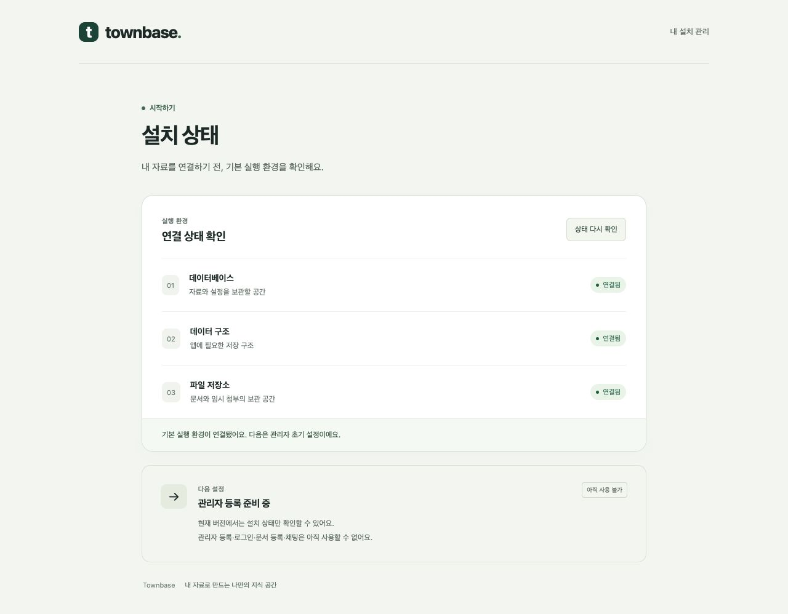
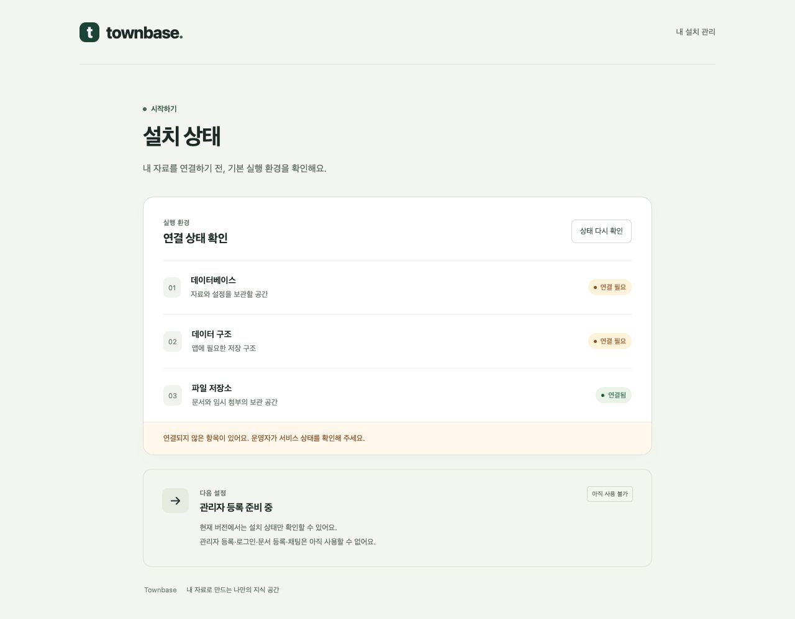

# V02B-B02 — 배포 기반 로컬 구현·검증

실행일: 2026-10-23 (Asia/Seoul). 기준 main `80cb3ab`, 작업 브랜치 `codex/v02-b02-deployment-foundation`. [실행 안내](../self-hosted-deployment.md), [TASK](../../TASK_v0_2_self_hosted_agent.md).

> PR #34 이후 권한·상태 점검·문서·화면 보완은 [리뷰 대응 및 추가 검증](v0.2-b02-review-response.md)을 따른다. 아래202개·이미지 ID는 최초 구현 당시 기록이다.

## 구현 결과

- React19.3.1·ReactDOM19.3.1·Vite8.3.5·plugin-react6.1.2를 공식 npm registry의 실제 버전/라이선스/Node 요건 확인 후 lockfile에 고정했다. 신규 주요 라이브러리는 MIT다. Node24.19.0·pnpm10.33.2 사용.
- API가 초기 웹과 상태 API를 같은 origin에서 제공한다. 초기 화면은 실측 연결 상태와 재확인 버튼만 제공하며 관리자 등록/로그인/문서/채팅이 미구현임을 명시한다. 가짜 로그인·채팅 버튼이나 자료는 없다.
- 기본 Compose는 내부 DB health → migration 성공 종료 → API 순서. DB 비밀은 별도 파일/서비스별 secret mount에서 읽는다. 기존 .env/DB volume은 자동 재사용하지 않는다. API는 node 사용자·read-only root·독립 문서/첨부 volume·loopback 호스트 포트만 사용한다.
- self_hosted 모듈은 기존 수집/Gap/draft/MCP 모듈을 등록하지 않는다. production에서 legacy_development를 지정하면 기동 실패. 기존 v0.1 개발은 compose.legacy.yml과 legacy_development를 통해 유지한다.
- 모든 공유 패키지 main/types를 dist로 정리하고 database build와 전체 root build 순서를 추가했다. API/공유 라이브러리의 배포 files를 dist로 제한했다. pnpm deploy가 누락하는 Prisma 생성 sibling을 명시 복사하고 이미지 build에서 import/생성자까지 검증한다. 실제 API는 TypeScript entrypoint를 실행하지 않는다.
- health는 생존, readyz는 DB·정확한 migration 집합·실제 기초 테이블·서로 중첩/동일하지 않은 디렉터리의 접근을 확인한다. 오류503·no-store, 비밀/경로/원문 미반환. 초기 설정과 채팅 capability는 항상 false다.

## 자동 검사

최종 Linux 컨테이너에서 **62 Jest suites / 200 tests + Node 배포 테스트2개 = 총202개 통과**. Darwin 개발 장비에서도 DB 통합을 제외한 동일 패키지 회귀185개+Node2개를 통과했다. 두 환경·중복 실행을 합산해 테스트 개수를 늘리지 않았다.

| 실행 | 최종 결과 |
| --- | --- |
| pnpm install --no-frozen-lockfile | 신규 웹 의존성 및 lockfile 갱신 |
| pnpm build | database→rag-core→agent-core→connectors→API→web 통과 |
| pnpm lint | API 소스/테스트 통과 |
| pnpm test | 20 suites / 66 통과 |
| pnpm db:test | 격리 townbase_b02_test DB, 6 suites / 25 통과 |
| pnpm connectors:test | 격리 DB 포함25 suites / 71 통과 |
| pnpm --filter @townbase/agent-core test | 5 suites / 15 통과 |
| pnpm --filter @townbase/rag-core test | 6 suites / 23 통과 |
| pnpm test:deployment | secret 누락/짧은 값 거절·URL 인코딩·준비 재실행 값 보존/상위 폴더0700, 2개 통과 |
| docker compose config --quiet | 기본 서비스/secret/volume 설정 유효 |
| docker compose build | 최종 Linux amd64 migration/runtime 이미지 빌드 통과, production Prisma artifact smoke 통과 |

새 API13문항은 프로필 선택/거절, 실제 상태 응답, 누락/동일/중첩/별칭 저장소503, legacy 경로404, migration 누락/추가/미완료/DB 장애/누락 테이블/연결 해제를 검증한다. `.js` 산출물을 ts-jest로 재변환하던 설정도 TypeScript만 변환하도록 정리했다.

## 실제 컨테이너·브라우저 검증

시험은 호스트 Darwin arm64의 Docker Desktop에서 **Linux x86_64 에뮬레이션**으로 수행했다. API process `linux/x64/v24.19.0`, PostgreSQL uname `x86_64`. 네이티브 Linux 장비의 성능/최소 사양 합격으로 주장하지 않는다.

전용 프로젝트 `townbase-v02-b02-test`, API localhost43120. 실제 .env/API Key·고객 문서 없이 수행했다. 최종 이미지에 대해 빈 volume부터 기동했다. 첫 이미지에서 드러난 누락 Prisma generated client는 수정 후 최종 빈 환경으로 다시 확인했다.

| 시나리오 | 관측 결과 |
| --- | --- |
| 빈 환경 기동 | DB 생성·8개 migration·workspace seed 후 API 시작, readyz200. 관리자/채팅 capability false |
| 정적 웹 | HTML·JS·CSS200, 같은 origin 요청, CSP/nosniff 응답. 실제 브라우저에서3개 연결 상태·미구현 안내·재확인 동작 확인 |
| 미노출 경로 | legacy 수집·Gap·MCP 및 .env/secret/문서/배포 파일 경로404. POST 수집/draft/MCP도 API 통합 테스트404 |
| 산출물 실행 | 실제 컨테이너에서 database/rag-core/agent-core의 resolve 결과.js·require 성공, API src 미포함, uid1000(node) |
| 재시작 | 별도 문서/첨부 volume에 쓴 marker와 DB workspace 행이 PostgreSQL/API 재시작 뒤 readback 일치 |
| DB 중단/복구 | health200 유지, readyz503에서 database/schema unavailable·storage ready. 브라우저는 연결 필요 안내. DB 복구 뒤 재확인 시200·연결됨으로 회복 |
| migration 동시 실행 | 같은 PostgreSQL advisory lock을 다른 세션이 소유한 동안 runner exit1. lock 해제 후 runner exit0, 기존 migration/seed 중복 생성 없음 |
| migration 실패 초기 기동 | 별도 빈 실패 시험 프로젝트에서 secret 경로를 의도적으로 잘못 지정. migration exit1, 신규 API는 Created/Running=false. 실패 프로젝트/volume 정리 |
| 운영 legacy 프로필 | 실제 운영 이미지에 legacy_development 지정 시 exit1, 서버 시작 거절 |
| 포트/권한 | API PortBindings 127.0.0.1:43120, readonly=true·user=node. DB PortBindings={} |

DB/volume marker와 townbase_b02_test DB는 시험 후 정리했다. 검토용 초기 화면의 API/DB만 localhost43120에서 유지한다. main/운영 서비스와 기존 DB는 변경하지 않았다.





## 핵심 실행 증거

원본 테스트·build·smoke 로그와 임시 시험 orchestration은 `/tmp/townbase-v02-b02/`에서 다뤘다. 아래 상태/개수/이미지 ID와 저장한 화면을 저장소 증거로 남긴다. 비밀 내용은 기록하지 않는다.

### runtime-image

```text
sha256:3e93a589a2aeefd09573c6eface3072b958607903c821641fe85500e74d6f377 amd64
```

### migration-image

```text
sha256:fb9f750efdf65e0e449b1a7aed39dbb0c76bc4d3434a8e6b7a44426c14c0b312 amd64
```

### postgres-image

```text
sha256:7b822b0aac60967beb1ea5e576b8602c94c300a157d187f385ae3e0da199b90a
```

### api-port-and-user

```text
{"3000/tcp":[{"HostIp":"127.0.0.1","HostPort":"43120"}]} readonly=true user=node
```

### db-port

```text
{}
```

### smoke-stage-a

```json
{
  "freshReadiness": {
    "database": "ready",
    "schema": "ready",
    "storage": "ready",
    "setup": "unavailable",
    "capabilities": {
      "administratorSetup": false,
      "chat": false
    }
  },
  "assets": [
    "/assets/index-BkUJJ6bq.js",
    "/assets/index-DwydYulz.css"
  ],
  "headers": {
    "X-Content-Type-Options": "nosniff",
    "Content-Security-Policy": "default-src 'self'; script-src 'self'; style-src 'self'; connect-src 'self'; img-src 'self' data:; object-src 'none'; base-uri 'none'; frame-ancestors 'none'"
  },
  "legacyAndPrivatePathsBlocked": true,
  "databasePersisted": true,
  "separateVolumesPersisted": true,
  "dbOutageStatus": 503,
  "dbOutageReadiness": {
    "database": "unavailable",
    "schema": "unavailable",
    "storage": "ready",
    "setup": "unavailable",
    "capabilities": {
      "administratorSetup": false,
      "chat": false
    }
  },
  "commands": [
    {
      "name": "final-fresh-clean",
      "exitCode": 0,
      "seconds": 2.06
    },
    {
      "name": "final-fresh-up",
      "exitCode": 0,
      "seconds": 19.57
    },
    {
      "name": "runtime-artifacts",
      "exitCode": 0,
      "seconds": 0.49
    },
    {
      "name": "write-volume-markers",
      "exitCode": 0,
      "seconds": 0.31
    },
    {
      "name": "write-db-marker",
      "exitCode": 0,
      "seconds": 0.21
    },
    {
      "name": "restart",
      "exitCode": 0,
      "seconds": 0.23
    },
    {
      "name": "read-volume-markers",
      "exitCode": 0,
      "seconds": 0.31
    },
    {
      "name": "read-db-marker",
      "exitCode": 0,
      "seconds": 0.21
    },
    {
      "name": "stop-db",
      "exitCode": 0,
      "seconds": 0.15
    }
  ]
}
```

### smoke-stage-b

```json
{
  "dbRecovery": true,
  "linuxAllTests": true,
  "duplicateMigrationRejected": true,
  "migrationRetrySucceeded": true,
  "failedMigrationBlocksNewApi": true,
  "failedProjectRemoved": true,
  "commands": [
    {
      "name": "duplicate-migration",
      "exitCode": 1,
      "seconds": 0.84
    },
    {
      "name": "migration-retry-after-lock",
      "exitCode": 0,
      "seconds": 3.95
    },
    {
      "name": "failed-migration-blocks-start",
      "exitCode": 1,
      "seconds": 6.36
    },
    {
      "name": "failed-api-id",
      "exitCode": 0,
      "seconds": 0.08
    },
    {
      "name": "failed-api-state",
      "exitCode": 0,
      "seconds": 0.02
    },
    {
      "name": "failed-project-cleanup",
      "exitCode": 0,
      "seconds": 0.27
    },
    {
      "name": "api-port-and-user",
      "exitCode": 0,
      "seconds": 0.02
    },
    {
      "name": "db-port",
      "exitCode": 0,
      "seconds": 0.02
    },
    {
      "name": "runtime-image",
      "exitCode": 0,
      "seconds": 0.03
    },
    {
      "name": "migration-image",
      "exitCode": 0,
      "seconds": 0.03
    },
    {
      "name": "postgres-image",
      "exitCode": 0,
      "seconds": 0.03
    }
  ]
}
```

## 한계와 전달 상태

- B02는 초기 실행 틀이다. 관리자/토큰/세션·실제 답변·파일 API·첨부 만료/백업 제외·운영 백업/복원은 아직 없다. volume persistence 시험을 파일 업로드/보관 정책 완료로 표현하지 않는다.
- TLS는 조직 제공 proxy/인증서 계약과 예시를 문서화했다. 실제 조직 도메인/인증서·로그인 cookie/CSRF·권한 검증은 B03/B04/B05 이후 별도 수행한다. 현재는 localhost HTTP의 상태 화면만 제공한다.
- 실제 모델 품질·사용량/비용·성능p95·네이티브 Linux 신규 장비·모바일 브라우저는 이번 시험 범위가 아니다. 외부 서비스 호출 없음.
- 로컬 구현·검증 완료. 2026-10-23 사용자 승인으로 구현 커밋 `a6749a9`를 작업 브랜치에 푸시하고 main 대상 [PR #34](https://github.com/Hugekyung/townbase/pull/34)를 생성했다. main 병합은 수행하지 않았다. 이전 main 직접 푸시는 B01 기록이며 이번 변경의 전달과 구분한다. interview.md는 수정하지 않았다.
