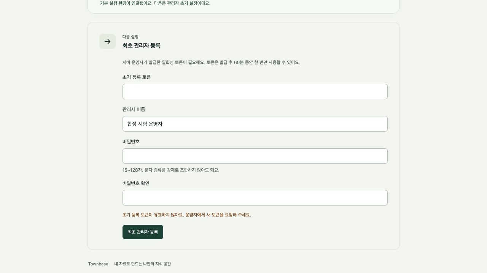
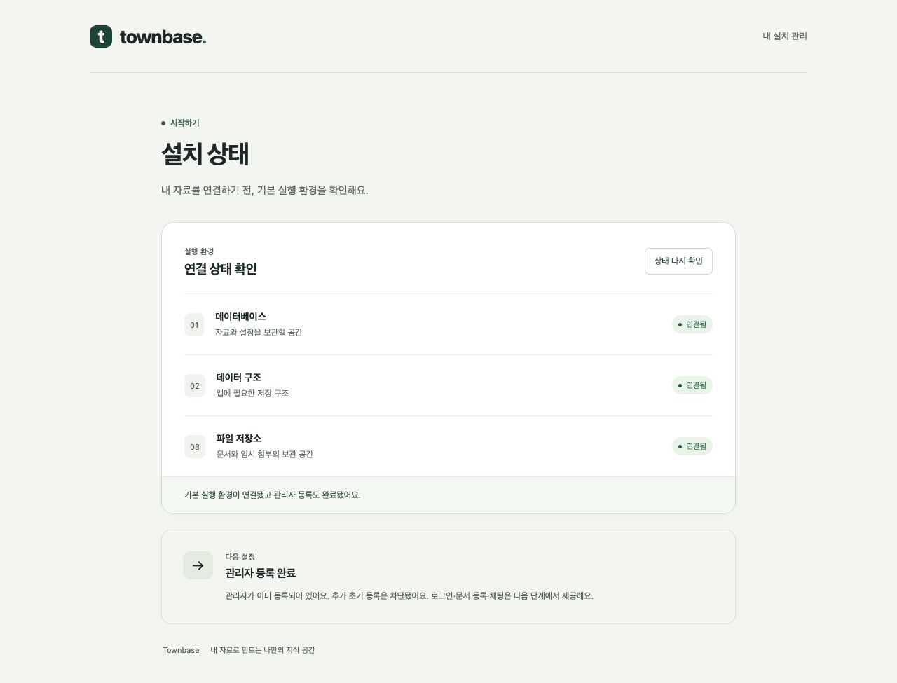

# V02B-B03 최초 관리자 등록

기준: 기본 v0.2 PRD/TASK, DECISIONS S03/S04/S14. main `24ad492`(PR #34 병합)에서 `codex/v02-b03-initial-administrator`로 분리했다. B03 로컬 구현·검증 기록이며 2026-10-24 사용자가 commit/push·main 대상 PR 생성을 승인했다. main 병합은 별도다. B04 로그인·세션·비밀번호 변경·복구는 미구현이다.

## 동작과 저장

- migration은 BootstrapState singleton만 준비한다. 운영자가 API 컨테이너의 `node deployment/bootstrap.mjs`를 실행해야 선택 workspace를 Installation에 연결하고 토큰을 발급한다. 기존 연결 불일치는 거절하고 기존 이름/시간대는 보존한다. 새 설치는 workspace 이름·UTC를 사용한다.
- 32-byte 난수는 보호된 bootstrap volume의 token 파일(0600·상위0700)에만 기록한다. CLI 성공 메시지·HTTP·로그에는 출력하지 않는다. DB에는 SHA-256 digest·발급/만료/소비 시각·시도 제한 상태만 저장한다.
- 발급·등록·정리는 같은 singleton 행을 잠근다. 잠금을 얻은 뒤 DB 시각으로 만료를 검사한다. 동시 요청은 하나만 성공하고 Administrator의 설치별 UNIQUE도 유지한다.
- 등록은 Administrator 실제 행·Argon2id hash·Installation.initializedAt·토큰 소비·감사 행을 한 transaction으로 저장한다. 감사 저장이 실패해도 전체를 되돌린다. 성공 후 별도 조회로 완료 상태를 읽는다.
- 초기화 표시 또는 관리자 행 하나라도 존재하면 등록과 재발급이 닫힌다. 비활성 관리자도 포함한다. 초기화 표시만 남은 손상 상태를 새 등록으로 우회하지 않는다.
- 15~128 Unicode 문자 비밀번호, 문자 종류 조합 강제 없음. 입력 공백을 보존한다. 이름은 trim 후 1~128자·제어문자 제외. 필수 세 필드 외 입력도 거절한다.
- `argon2@0.45.1`: Argon2id v19·19456KiB·t2·p1·32-byte hash. 라이브러리 출력 m,p,t와 기존 DB의 m,t,p 두 순서를 허용하도록 **새 B03 migration**에서 검사식을 확장했다. 기존 적용 migration은 수정하지 않았다. 실제 생성 hash를 DB에 저장하고 verify로 검증한다.
- 실패 15분 10회부터 1·2·4…최대60초 지연. DB에 저장하므로 다른 클라이언트/프로세스도 같은 제한을 받는다. 로컬 재발급은 새 토큰으로 교체하고 제한을 초기화한다.

## 노출·전송 경계

`GET /setup/status`는 required/complete만, `POST /setup/administrator`는 등록 결과만 반환한다. no-store, JSON8KiB 제한, 안전한 오류 코드를 적용한다. 잘못된 JSON/너무 큰 본문에도 입력 원문을 오류 응답·로그에 남기지 않는다. 토큰 발급 HTTP 경로는 없다.

등록은 같은 Origin/Host·전용 헤더가 필요하다. 기본 Compose는 loopback 로컬 HTTP를 명시 허용하고 전달 헤더가 있는 로컬 요청은 거절한다. 공개 origin을 설정하면 HTTPS origin 일치와 정확히 신뢰한 proxy peer의 https 전달 값이 필요하다. 전체 trust proxy는 켜지 않는다. 실제 TLS 인증서·조직 proxy 검증과 로그인 cookie는 이 단계의 완료 근거가 아니다.

API runtime DB 권한은 여섯 상태/설정 테이블 SELECT, Installation/Administrator/InstallationAuditEvent INSERT, BootstrapState UPDATE, Installation initializedAt/updatedAt UPDATE다. 문서 읽기·관리자 UPDATE/DELETE·설치 이름 UPDATE·schema DDL·역할 관리·권한 위임은 허용하지 않는다. 기존 사용자 schema·열·sequence·루틴·기본 ACL 검사도 유지한다.

웹은 토큰/비밀번호를 가려 입력하고 비밀번호 확인 불일치를 안내한다. 서버 요청 후 성공/실패 모두 비밀 입력을 비운다. 등록 응답 후 readyz를 다시 읽어 완료를 표시하며, 통신 결과가 불명확하면 상태 재확인을 안내한다. 브라우저 저장소에 비밀을 저장하지 않는다.

## 삭제와 장애

소비 직후 원문 파일을 삭제하고 기동/60초 주기로 만료·소비 파일과 중단된 atomic write의 임시 파일을 정리한다. 살아 있는 토큰은 보존한다. DB/파일 장애나 API 중단 중 물리 삭제는 미뤄질 수 있지만 만료 토큰의 등록은 거절한다. 정리 실패는 비밀값 없는 경고를 남기고 재시도한다. bootstrap volume은 데이터 백업에서 제외할 대상이며 자동 백업 기능은 아직 없다.

파일 교체와 DB commit은 서로 다른 저장 장치라 완전한 원자성을 보장하지 않는다. 교체 후 commit 전 중단으로 불일치하면 등록이 실패한다. 운영자가 초기화 전 로컬 재발급으로 복구한다. 등록 완료 설치를 자동 초기화하지 않는다. [실행 명령·TLS 설정](../self-hosted-deployment.md#7-최초-관리자-등록-b03)을 따른다.

## 검증 환경·재현

2026-10-24, 로컬 Docker Desktop의 Linux amd64 에뮬레이션. 프로젝트 `townbase-v02-b03-test`·호스트 loopback43140, 별도 합성 secret/volume. 실제 조직 DB·원문·모델 Key는 사용하지 않았다. 네이티브 Linux 성능·실제 조직 TLS·로그인 보안 완료와 구분한다.

일반 명령: `pnpm build`, `pnpm lint`, 합성 DATABASE_URL로 `pnpm db:validate`. DB 없는 일반 `pnpm test`는 setup 통합 suite를 건너뛴다. 명시 시험은 `postgres` 호스트의 `townbase_b03_test`만 허용한다. owner DATABASE_URL, runtime secret 파일, 적용한 migration과 기본 workspace가 필요하다. runtime-role 별도 시험은 기존 안전 장치에 맞는 `townbase_pr34_b03_test`를 사용한다. 두 DB 모두 시험 프로젝트 안에서만 생성/삭제했다.

migration 이미지 안에서 owner URL을 `databaseEnvironment()`로 구성한 뒤 다음 명령을 실행한다. secret을 shell 인자나 출력으로 넘기지 않는다.

```js
import { databaseEnvironment } from './deployment/database-env.mjs';
import { execFileSync } from 'node:child_process';
process.env.DATABASE_URL = databaseEnvironment();
// POSTGRES_DB=townbase_b03_test, TOWNBASE_RUNTIME_PASSWORD_FILE 필요
process.env.TOWNBASE_SETUP_INTEGRATION = '1';
execFileSync('pnpm', ['test'], { stdio: 'inherit', env: process.env });
// 별도 townbase_pr34_b03_test에서 실행:
// execFileSync('node', ['--test', 'deployment/test/runtime-role.integration.mjs'], ...)
```

기존 DB·connector·rag·agent 회귀는 각 package의 test script와 root `pnpm test:deployment`를 실행한다. 통합 suite는 독립 owner readback과 두 runtime Prisma 클라이언트로 파일 권한·digest·hash 검증·만료·재발급·경합·지연·행/감사 rollback·완료 후 폐쇄·저장 경로 symlink 거절·임시 파일 정리를 확인한다.

## 최종 검증 결과

- 자동 시험 **271개 통과**, 실패/skip 0: database25 + connectors71 + rag23 + agent15 + API103(실 DB setup14 포함) + 배포4 + runtime-role30. 최종 웹 안내 수정은 전체 Docker 재빌드와 브라우저에서 추가 확인했다.
- `pnpm build`, `pnpm lint`, `pnpm db:validate` 통과. production runtime 이미지에서 실제 native Argon2 hash 생성·DB 저장·verify 성공. 별도 API 토큰 발급 명령도 최종 이미지에서 성공했다.
- 같은 최종 runtime 이미지에서 합성 비밀번호20건을 순차 실측했다. hash 중앙값16ms·p95 21ms, 올바른 비밀번호 verify 성공/오답 거절. 이 장비·실행 시점의 관측값이며 네이티브 배포/동시 부하의 성능 보장은 아니다.
- 실제 HTTP에서 상태만 공개, 기존 경로404, 외부 Origin/전달 헤더403, 잘못된 토큰401, 잘못된 JSON400/8KiB 초과413를 확인했다. 본문 canary·토큰·비밀번호가 응답/로그에 없는지 확인했다.
- 브라우저에서 비밀번호 확인 불일치, 토큰 오류 안내와 비밀 입력 초기화, 유효한 합성 계정 등록 후 상태 재조회·완료 화면을 확인했다.
- 등록 후 독립 owner DB 조회: 관리자1·초기화 완료·digest 제거/소비 시각·발급/소비 감사 각각1. 원문 파일 삭제, 재등록409, 로컬 재발급 실패도 확인했다. PostgreSQL/API를 함께 재시작한 뒤 complete 상태가 유지됐다.
- 권한 추가 시험3개: 필요한 등록 쓰기 유지, 문서 접근/관리자 수정·삭제/설치 이름 수정 차단, PUBLIC의 불필요한 열 UPDATE 거절, 직접 INSERT 위임 권한 제거. 기존27개 권한 시험도 모두 유지했다.
- 초기 실패 시험에서 node-argon2의 m,p,t 직렬화와 B01의 m,t,p 검사식 불일치를 발견해 새 migration으로 수정했다. 중단된 파일 쓰기의 임시 원문도 정리하도록 보완하고, 새 격리 volume에서 재시험했다.





참고: [node-argon2 공식 저장소](https://github.com/ranisalt/node-argon2), [OWASP 비밀번호 저장 지침](https://cheatsheetseries.owasp.org/cheatsheets/Password_Storage_Cheat_Sheet.html). Argon2 비용은 승인된 시작값이며 실측 없이 모든 장비의 성능을 보장하지 않는다.

검토용 격리 설치는 loopback `http://127.0.0.1:43140`에 등록 완료 상태로 남겼다. 운영 설치와 다른 프로젝트이며 자동 시험 DB도 이 프로젝트의 내부 PostgreSQL에만 있다. 종료는 해당 시험 프로젝트에 한정한 Compose 명령으로 수행한다.
