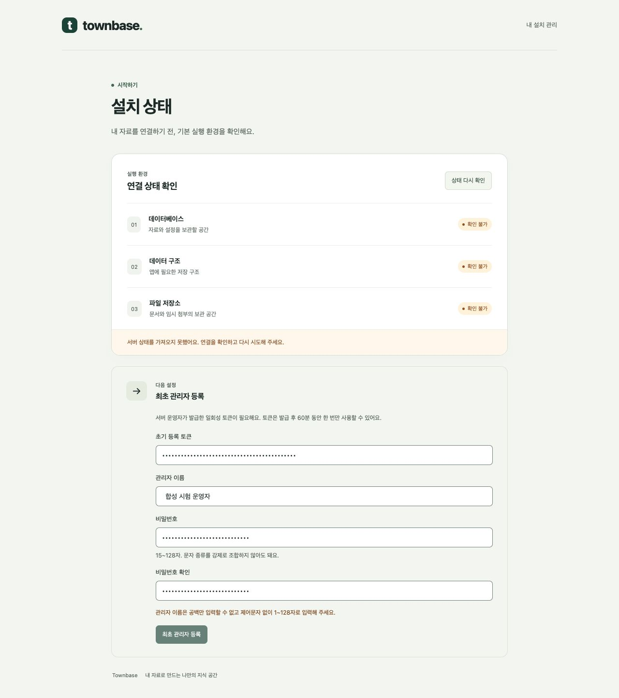
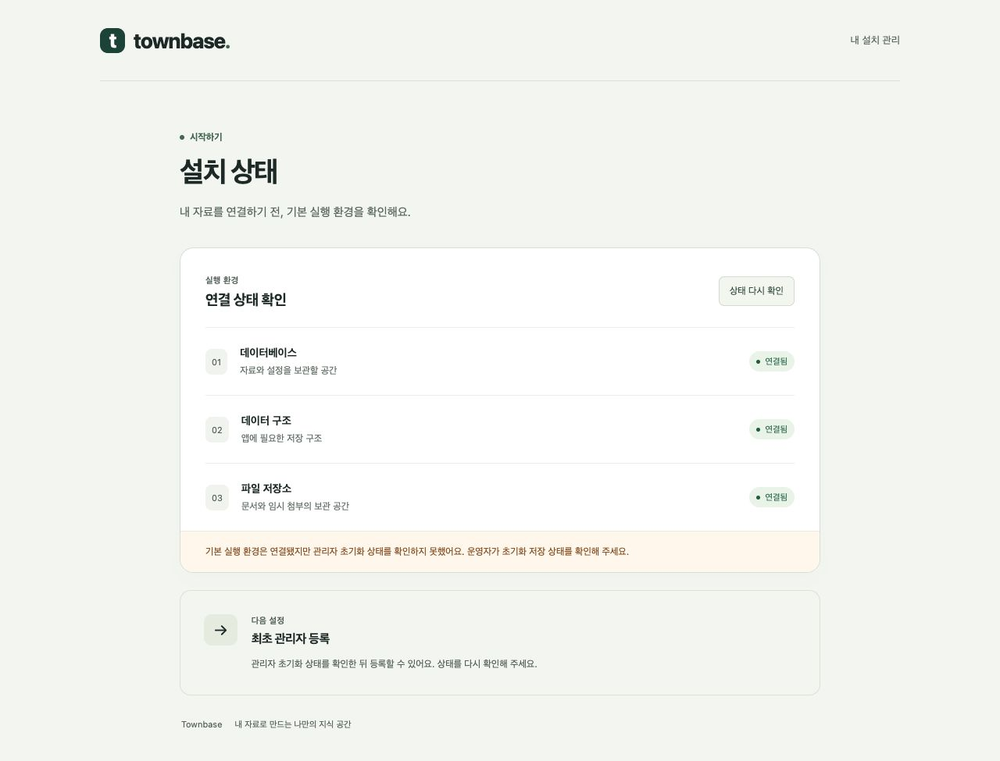

# PR #35 리뷰 대응

기준 head `174d62d`, cubic 리뷰 18건(타당14·부분 타당4). 사용자에게 판단 근거를 제시한 뒤 2026-10-24 수정·커밋·푸시·PR 댓글 등록을 승인받았다. 기존 `interview.md`는 작업에서 제외한다. 리뷰 스레드 해결 처리는 수행하지 않는다.

## 반영 내용

| 리뷰 ID 끝자리 | 위치 | 반영 |
| --- | --- | --- |
| 7275 | style.css | 입력 테두리 #7f8f84. 흰색 대비3.41:1 |
| 7313 | SetupForm | 이름 trim·공백/제어문자/Unicode 길이 검증 후 제출 |
| 7322 | main.tsx | 상태 재조회 중 입력 보존, 조회 중/실패 시 제출 금지, 등록 중 재조회 금지 |
| 7330 | setup.integration | initializedAt을 null로 바꾼 뒤 비활성 관리자 행만으로 등록/재발급 차단 확인 |
| 7342 | main.ts | 실제 entrypoint와 같은 HTTP 설정 함수를 사용해 malformed/oversized JSON 오류 자동 시험 |
| 7349 | runtime-role 시험 | Administrator UPDATE·Document SELECT/INSERT/UPDATE의 열 권한 검사와 실제 PUBLIC 열 grant 거절 시험 |
| 7358 | Vite proxy | /setup 전달 추가. Host/Origin 보존·실제 API 등록 경로 시험 |
| 7365 | DECISIONS | 중복 구현 설명을 링크로 줄이고 B01/B02/B03 상태 갱신 |
| 7370 | AGENTS | BootstrapState 테이블 UPDATE와 Installation 지정 열 UPDATE 구분 |
| 7376 | controller 시험 | 등록 성공 POST의 no-store 헤더 확인. JSON 오류 응답 헤더도 확인 |
| 7388 | transport | peer와 설정 IP의 대소문자·IPv4-mapped 표기를 같은 방식으로 정규화 |
| 7396 | issue-token | 서비스 만료 시각과 CLI 안내가 같은 TTL 상수 사용 |
| 7405 | issue-token | 허용한 자체 오류 코드·고정 메시지만 출력. 알 수 없는 DB/파일 오류 원문과 stack은 계속 차단 |
| 7408 | token-file | 내용 sync → rename → 디렉터리 sync 순서 보장·시험 |
| 7412 | token-file | 임시 파일 prefix/suffix를 생성·정리에 공유. 구형 임시 이름도 계속 정리 |
| 7419 | HTTP 설정 | 미지원 charset/encoding은415, 잘못된 JSON400·초과413 유지 |
| 7428 | HTTP 설정 | 보안 헤더를 body parser보다 먼저 등록. 파서 오류에도 헤더 유지 |
| 7434 | main.tsx | 인프라 정상·setup unavailable을 구분해 초기화 저장 상태 확인 안내 |

부분 타당 항목의 선택: 이전 상태를 유지하되 오래된 성공 상태로 제출하지 않게 잠근다. Vite 개발 경로만 보완하고 Docker 기본 실행·공개 HTTPS 보호를 유지한다. 선택 문서는 확정값/구현 의존성·연결 선택만 남긴다. 오류 진단은 원문 메시지 대신 허용된 오류 코드로 개선한다.

## 검증

시험은 `townbase-v02-b03-test` 프로젝트의 두 격리 DB와 합성 자료에 한정한다. 실제 TLS 운영 검증·로그인/세션/복구는 후속 범위다. DB/파일의 별도 저장 장치 경계와 장애 시 초기화 전 로컬 재발급 복구 계약은 그대로 유지한다.

- 자동 회귀 **289개 통과**: database25 + connectors71 + rag23 + agent15 + API116(실 DB setup15 포함) + 배포5 + runtime-role34. 실패/skip 0. Vite 소스/proxy 시험은 build stage를 상속한 migration 이미지의 읽기 전용 root·/tmp 캐시 환경에서 통과했다. 배포 API의 runtime 이미지는 Vite 소스/개발 의존성 대신 `/app/web/dist`만 포함하며 실제 등록·재조회·재시작 시험은 이 runtime API를 대상으로 별도 수행했다.
- `pnpm build`·`pnpm lint`·Docker build·`git diff --check` 통과. API 설정 공유 함수로 400/413/415·비밀값 제거·보안 헤더·no-store 시험을 추가했다.
- Vite43141 → loopback 시험 gateway3000 → 합성 API43140으로 실제 브라우저 확인: 공백 이름 POST0, 조회 지연 중 입력/폼 보존·제출 차단, 조회500 뒤 입력 보존/제출 차단, 초기화 unavailable의 별도 안내, 등록 중 재조회 차단.
- 실제 Vite 등록 시험에서 문자열 proxy가 Host를 자동 변경하는 문제까지 발견했다. `changeOrigin:false`, `xfwd:false`를 명시한 뒤 등록·완료 상태 재조회 성공. 실제 Vite proxy를 띄우는 자동 회귀 시험으로 /readyz·/setup/status·/setup/administrator의 Host/Origin·전달 헤더 경계를 고정했다.
- 독립 DB 재조회·native Argon2 verify·토큰 파일 삭제/소비 감사·재등록409/재발급 차단·DB/API 재시작 후 완료 상태 유지 확인. CLI의 workspace 누락 출력도 안전한 고정 코드만 포함하는지 확인했다.
- 운영 환경/TLS 공개는 수행하지 않았고 로그인·세션·복구는 B04에 남긴다. 시험용 Vite/gateway는 확인 후 종료한다.

## 2차 리뷰 보완 (기준 d9d65db)

신규5건 중 타당4·부분 타당1. 구현·검증 요약 후 2026-10-24 사용자가 commit/push·PR 댓글 등록을 승인했다.

- 1167: 개발 전용 checkout·Docker API→Vite 순서와 선행 웹 빌드·실제 환경 변수/설정 위치를 명시했다.
- 1185: proxy upstream이 요청 본문을 끝까지 읽은 후 합성 토큰/한글 이름/비밀번호·JSON Content-Type까지 검증한다. 실제 비밀을 시험 응답에 반사하는 기능이 아니라 임시 loopback 시험 서버와 합성 fixture에 한정한다.
- 1191: 명시적 SetupIssueError의 unavailable도 진단 표에 추가했다. 일반 오류 fallback/원문 차단 시험은 유지한다.
- 1199: Vite 소스/proxy 시험의 migration/build 이미지와 실제 배포 API runtime 이미지 검증을 구분했다. 앞선 시험이 runtime stage에서 실행됐다는 뜻이 아니며, runtime에 Vite를 넣지 않는다.
- 1231: 정상적으로 확인한 assets 파일만 정적 제공 단계에서 재검증 가능한 캐시 정책으로 바꾼다. API 기본 no-store와 보안 헤더는 유지하고 HTML·404·파서 오류는 정적 URL이어도 캐시하지 않는다. GET/HEAD/304·정상 범위206와 오류 경로를 같은 실제 서버 설정으로 시험한다. 파일 lookup 뒤의 조건412/범위416·전송 오류도 아직 헤더가 전송되지 않았다면 no-store로 되돌린다.

### 반복 리뷰 분석과 적용

PR #35 최초18건+2차5건을 원인 기준으로 하나씩 분류했다. 이 분류의 수치는 PR #35에만 해당한다. 이전 PR #34에서는 배포 권한의 schema/열/루틴·기본 ACL 우회, 실행 명령/포트/산출물 안내, 오류 원문 차단과 화면 대비 지적이 반복됐다. 두 PR 모두 각 기능의 정상 동작뿐 아니라 주변 경계·재현 안내까지 검토해야 한다는 공통점이 있다.

| 반복 원인 | PR #35 건수 | 이번부터 적용할 확인 방식 |
| --- | --- | --- |
| 자동 시험의 입력/분기/보호 범위 누락 | 6 | 정상 응답만 보지 않고 실제 본문·헤더·저장 결과, 실패/경합/우회 경로, 서로 독립된 차단 조건까지 확인 |
| UI 입력·오류 상태·접근성 | 4 | 재조회·실패·진행 중 화면을 실제로 실행해 입력 보존/잠금/복구와 대비 확인 |
| 실행 환경·설정·보안 정책의 연결 영향 | 5 | 실제 proxy/정적 서버/DB 권한까지 연결하고 변경 대상 이외 경로의 영향도 확인 |
| 문서 재현성·검증 범위 설명 | 4 | 복사 가능한 선행 명령·변수·이미지 stage·실행/미실행 범위와 증거를 분리 기록 |
| 운영 진단·공통 규칙·저장 내구성 | 4 | 현재 필요한 공통 규칙만 한 곳에 두고 실제 생성/소비/삭제·장애 시 결과 확인 |

시험이 통과했다는 이유만으로 미검증 경로까지 보장하지 않는다. 새 보호 설정을 추가할 때는 반대쪽 정상 경로도 확인하고, 시험/문서 수정에도 제품 코드와 같은 검토를 적용한다. 지적이 반복된 경계를 구체적인 시험과 저장소 지침으로 남긴다.

### 2차 보완 검증 결과

2026-10-24, 로컬 구현·검증 완료 후 사용자 승인으로 기존 PR #35에 보완 commit/push·검증 요약 댓글을 전달하는 경로를 따른다. main 병합은 별도다.

- 영향 범위인 **API129개(실 DB setup15 포함)·배포5개, 총134개 통과**, 실패/skip0. API의 정상 JS/CSS GET·HEAD·304, HTML no-store, 없는 파일/경로·dotfile404, 파일 lookup 뒤412/416 및 정상206, assets URL의 JSON 오류를 검증했다. 명시적 unavailable 진단1개도 추가했다.
- 위 시험은 `postgres` 호스트의 `townbase_b03_test`만 허용한 합성 DB와 migration/build 이미지에서 실행했다. Vite proxy의 합성 토큰·한글 이름·비밀번호 전체 본문과 Content-Type 도착을 확인했다. 기존 DB 권한/connector/rag/agent 코드는 바뀌지 않아 이번에는 재실행하지 않았다. 앞선289개 전체 회귀 기록과 이번134개를 합산하지 않는다.
- 별도 **배포 API runtime 이미지**를 재생성하고 loopback43140에서 실제 빌드 JS/CSS 두 파일을 조회했다. 정상 GET/HEAD200·ETag 재검증304·부분206은 `public, max-age=0`, HTML·setup API·404·정적 조건412/범위416·합성 JSON400/413/415는 no-store 유지. 보안 헤더·오류 원문 차단·기존 등록 complete 상태를 확인했다.
- `pnpm build`, `pnpm lint`, Docker build, `git diff --check` 통과. DB migration/운영 설치/실제 조직 TLS는 변경하지 않았다. `interview.md`는 제외했다.
- 실행 안내는 새 개발 checkout·별도 Compose 프로젝트 기준으로 기존 설치와 분리했다. 기본 Compose의 실제 환경값과 Docker build의 API/공유 패키지/웹 산출물 준비를 명시하고, 선행 host 웹 build도 명령으로 추가했다. 사용자 운영 secret이나 운영 DB로 안내를 실행하지 않았다.
