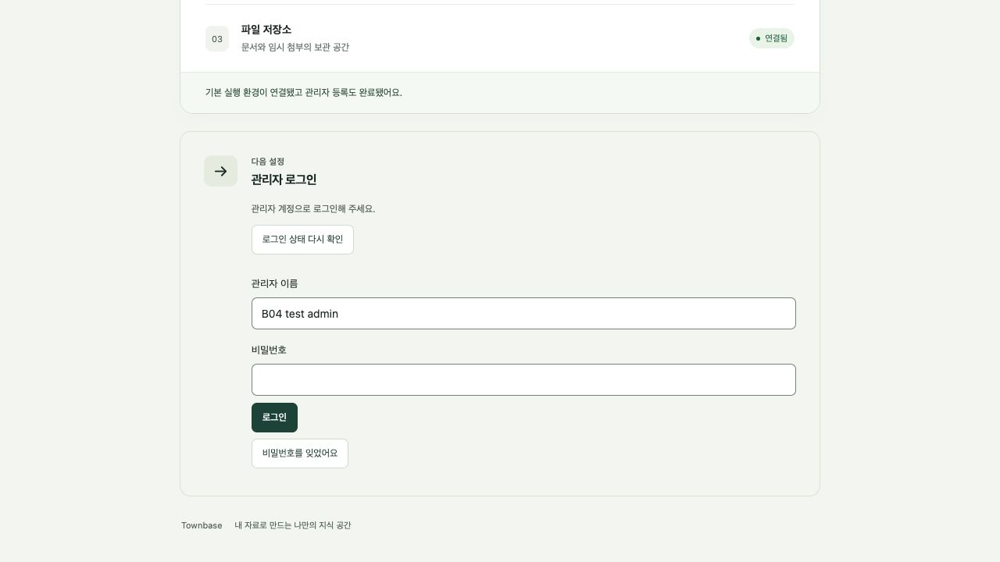

# PR #36 — B04 리뷰 대응

기준 commit `6c29181`, Cubic 최초 리뷰17건. 중복/오래된 항목 없음. 2026-10-24 로컬 보완·검증을 마쳤고 사용자가 후속 commit/push를 승인했다. PR 답글 등록과 원격 thread 해결 처리는 수행하지 않았다. 후속 commit `bcba158`로 전달했고 PR #36은 main `3cc61de`로 병합됐다. 아래 번호는 GitHub comment ID의 끝4자리다. 리뷰 thread의 원격 해결 상태와 로컬 수정 상태를 구분한다.

## 항목별 대응

| 댓글 | 위치 | 판정 | 적용 내용·검증 |
| --- | --- | --- | --- |
| 4007 | AuthPanel:47 | 타당 | 세션 조회401이면 password 모드만 login으로 복귀. recovery는 유지. 실제 DB 세션 만료 후 브라우저에서 확인 |
| 4019 | AuthPanel:211 | 타당 | 복구 토큰 입력을 password type으로 가림. 기존 초기 등록도 이미 가림이며 유지. 실제 DOM type과 복구 모드 재조회 확인 |
| 4010 | runtime-role 시험:252 | 타당 | Administrator의 passwordHash/updatedAt 외 모든 열 UPDATE 금지를 pg_attribute로 확인. id/installationId/disabledAt/createdAt의 PUBLIC grant 거절도 추가 |
| 4013 | runtime-role 시험:247 | 부분 타당 | 기존 실 DB current 호출도 권한을 간접 검증했지만 ACL 명시 검사 추가. lastSeenAt 갱신 후 readback 시각 증가까지 검증 |
| 4022 | auth HTTP 시험:58 | 타당 | Set-Cookie 정확히1개, 응답 본문·다른 모든 응답 헤더에 token 원문 부재 검사 |
| 4015 | auth-policy:9 | 타당 | 비밀번호 검사를 setup/password.ts로 모아 최초 등록·로그인·변경·복구에서 공유. 기존 경계·실 DB 회귀 확인 |
| 4017 | auth.service:75 | 부분 타당 | 세션 조회는 공유 잠금으로 병렬 허용. 변경은 배타 잠금 유지. 세션 행 잠금 뒤 새 DB 시각으로 만료 검사. 공유 조회/배타 무효화와 행 잠금 대기 중 만료를 실 DB 검증. 아래 선택 근거 참고 |
| 4024 | DECISIONS:88 | 타당 | 상단 B03 병합/B04 PR 검토/실제 모델 미구현 상태와 하단 잠금 설명 동기화 |
| 4027 | 배포 문서:102 | 부분 타당 | HTTPS 문맥·8절 예외가 있었으나 Secure의 공개 HTTPS origin 조건과 loopback HTTP 예외를 문장에 명시 |
| 4031 | 복구 CLI:16 | 타당 | RecoveryIssueError와 허용된3개 코드로 관리자/저장소/DB·기타 장애 구분. 알려지지 않은 메시지·stack 비노출 시험 |
| 4033 | DB readiness:49 | 타당 | 일반 테이블은 제한된 EXISTS 조회로 교체. 필요한 singleton 두 행만 count 검사. 세션·감사 전체 행 집계 제거 |
| 4035 | schema:181 | 부분 타당 | 기존 첫 열은 installationId였음. 실제 폐기 조건에 맞게 (installationId,revokedAt)로 교체. 공개된 migration은 보존하고 후속 migration으로 처리 |
| 4036 | auth.controller:101 | 타당 | 만료/폐기/없는 세션의 로그아웃도200과 cookie 삭제. DB 장애503은 cookie 유지. HTTP 회귀 시험 |
| 4039 | auth.controller:40 | 부분 타당 | 예외 원문 대신 작업 종류·허용 진단 코드만 서버 기록. 일반/연결/트랜잭션 장애 분류와 비밀 canary 비노출 시험 |
| 4041 | auth-transport:33 | 타당 | cookie Max-Age를 SESSION_ABSOLUTE_MS에서 초로 환산. 발급/삭제 시 HTTPS Secure 보호 확인 |
| 4044 | token-file:45 | 타당 | bootstrap/recovery 선택 용도를 설정·분리·안전성 오류에 반영. 알 수 없는 OS 오류 원문은 CLI에서 출력하지 않음 |
| 4047 | auth.service:326 | 타당 | 로컬 발급 잠금 안에서 잔여 임시 파일 정리. 실제 파일 삭제와 무관한 파일 보존, 실패 시 storage_unavailable 검증 |

## 잠금 변경의 선택 근거

인증 상태의 FOR SHARE는 세션 조회끼리 호환되고 FOR UPDATE인 변경/복구/로그아웃과 충돌한다. 같은 세션의 lastSeenAt은 세션 행 잠금 뒤 갱신하여 활동 시각 역전과 잠금 대기 중 만료 우회를 막는다. 잠금 순서는 항상 인증 상태→세션 행이다. 단순히 검사를 잠금 밖으로 이동하여 무효화와 경쟁하도록 만들지 않는다.

비밀번호 검증·새 hash 생성은 변경의 배타 잠금 안에 유지한다. 권한 확인·시도 제한·현재 비밀번호·복구 토큰의 유효성 판단과 저장을 한 경계에서 처리하기 위한 선택이다. 이를 밖으로 옮기려면 최종 잠금 안의 자격 증명 재검증과 병렬 실패 시도 제한을 함께 설계해야 한다. 현재 단일 관리자 설치에서 실측 병목이 확인되지 않은 상태에서 이 복잡도를 추가하지 않는다. 따라서 세션 조회 간 직렬화는 해소하되 비밀번호 변경 중 조회 대기는 의도적으로 유지한다. 부하 한계나 p95 개선을 실측했다고 주장하지 않는다.

## 반복 누락 방지에 적용한 검사

- UI: 비밀번호 변경 모드→실제 유휴 만료→세션 재조회→로그인 폼 복귀. 복구 모드→비로그인 재조회→복구 폼 유지. token type=password 확인.
- 응답: 성공 본문뿐 아니라 모든 헤더·cookie 개수, 이미 만료된 로그아웃, 장애503의 cookie 보존을 확인.
- 권한: 허용한 lastSeenAt/revokedAt과 금지한 모든 관리자 식별 열·세션 식별/만료 열을 함께 검사.
- 파일/운영: CLI 발급 경로를 lifecycle과 구분해 임시 파일 실제 삭제·무관 파일 보존·오류 분류를 확인.
- 일관성: 초기 등록과 새 인증의 비밀번호 규칙, DB/cookie 수명, 선택 문서의 상단 상태와 하단 구현 설명을 대조.

## 검증 결과

자동 시험 총224개 통과: API/B03 실제 DB142, B04 실제 DB22, 배포5, ACL43, DB 없는 단위12. 이전208개와 합산하지 않는다. 일반 API 실행은127개 통과이며 명시 opt-in인 B03/B04 suite는 별도 격리 DB에서 실행했다.

- DB는 postgres 호스트의 townbase_b03_test/townbase_b04_test/townbase_pr34_b04_test만 사용했다. B04 실제 이미지·브라우저는 합성 townbase-v02-b04-test 설치의 loopback43150을 사용했다.
- 후속 index migration을 기존 합성 설치 및 세 시험 DB에 적용하고 재실행 가능한 기동을 확인했다. 최초 인증 migration의 checksum은 변경하지 않았다.
- 최종 소스의 빌드·lint·schema validate 및 diff 공백 검사 통과. 새 회귀 시험16개를 추가했고 기존 시험의 검사 범위도 강화했다. 실제 조직 TLS·전체 제품 E2E·운영 백업/복원·성능 수치는 별도다.

